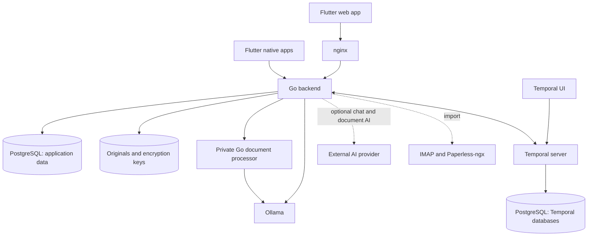

# How Domabas works

Domabas is a document library you run yourself. The Flutter app is the part people
see. A Go backend checks permissions, stores information and runs background work.
PostgreSQL keeps the records, files live on persistent disk, and Temporal helps
long jobs survive restarts.

This page explains the main ideas. The [architecture index](docs/arch/index.md)
links to the detailed guides, and the [code pattern map](docs/arch/code-patterns.md)
connects those guides to the implementation. For installation and commands, use
[the README](readme.md) and [development guide](docs/development/index.md).

## The components

| Component | What it does |
| --- | --- |
| **Flutter app** | Shows documents, invoices, chat, imports, jobs and settings. The same codebase targets web, Android, iOS, Linux, macOS and Windows. |
| **nginx web server** | Serves the built web app and forwards its API and live-update requests to Go. Browser requests use the same public address. Native apps connect to their saved server address. |
| **Go backend** | Handles the HTTP API, checks access, coordinates changes and runs Temporal workers and dispatchers in the same process. |
| **PostgreSQL** | Stores users, libraries, metadata, extracted text, search vectors, settings, conversations and job progress. Separate databases hold Temporal's own records. |
| **Temporal server** | Records workflow progress and sends tasks to the Go workers. It can resume orchestration after a process restarts. |
| **Temporal UI** | Gives operators a technical view of workflow executions. The app's Jobs screens provide the user-facing view. |
| **Private document processor** | Reads PDFs, images and email files. It extracts text, performs OCR, renders thumbnails and asks Ollama for embeddings. It is a separate Go process with resource limits. |
| **Ollama** | Runs the local embedding model and, when used, the models for chat and document AI. Model files are cached persistently. |
| **Optional external AI provider** | An administrator can select an OpenAI-compatible endpoint for chat or document AI. Those requests send their selected content to that provider. Local embeddings still use Ollama. |
| **Persistent volumes** | Keep originals, staged uploads, database files, encryption keys and model caches across ordinary container shutdowns. |
| **Initialization containers** | Prepare database roles, Temporal's schemas and namespace before the backend starts. They are setup steps, not extra application servers. |

Some components are libraries inside those processes rather than separate
services. **pgx** manages PostgreSQL connections, and **Jet** supplies generated
SQL builders. **pgvector** adds vector similarity search; **pg_trgm** helps find
similar spellings. **PDFium**, running through **wazero** WebAssembly, reads and
renders PDFs. **Tesseract** recognizes text in images, using **Leptonica** for image
processing. **Argon2id** hashes account passwords, and **Casbin** evaluates the
registered access rules. On the client, **Bloc/Cubits** keep screen state separate
from widgets. **OpenAPI generators** produce the shared HTTP boundary, while
**Go Task** and **Bun** run development and build commands.

## From an upload to a searchable document

1. The backend checks the user's library and upload permission, validates the
   file, and puts it in staging storage.
2. It saves the document and a durable request to process it in one database
   transaction. That saved request is an **outbox**: work remains recorded even
   if the backend stops before it contacts Temporal.
3. A dispatcher waits for available worker and Ollama capacity, then starts the
   document's Temporal workflow using a stable identity.
4. The processor keeps text already present in a PDF and uses OCR for image
   content. Email files are parsed as email. The backend saves the extracted text
   and divides it into small overlapping passages.
5. Ollama turns the passages into embeddings. The backend stores them, moves the
   original into its final location and publishes the completed search index.
6. A separate follow-up pipeline handles invoice extraction and any enabled
   document AI. A failure there leaves the document searchable. Thumbnail jobs
   separately create the previews used in document lists.

Uploads from mobile share sheets, the scanner, IMAP and Paperless ultimately use the same document
pipeline. Metadata-only records do not start file processing. Users can correct
extracted text; lexical search sees the correction while new embeddings are
prepared. See [document ingestion](docs/arch/backend/document-ingestion.md),
[email ingestion](docs/arch/backend/email-ingestion.md) and
[Paperless import](docs/arch/backend/paperless-import.md).

## Scheduling, jobs and Temporal

Three pieces work together. The **database job record** says what was accepted and
what progress users should see. The **resource scheduler** decides when the work
may start. **Temporal** records and coordinates the execution after it starts.

Each admitted job reserves one worker permit. Ingestion also reserves Ollama;
chat and enabled document AI reserve their selected provider. Email retrieval,
Paperless retrieval and thumbnails need a worker permit but no model permit.
Limits apply across backend instances. All required capacity is reserved together,
so a job does not occupy one resource while waiting for another. Older jobs that
can run get priority; one busy provider does not block unrelated work.

Administrators change these limits in workload settings. Lowering a limit lets
running work finish and holds back new work. A permit is released only when the
backend can establish that the execution has closed safely. Waiting jobs remain
in PostgreSQL and do not occupy Temporal activity slots.

A **workflow** describes the order of steps. An **activity** performs the real
work, such as reading a file, calling a model or writing a result. Temporal keeps
an event history and replays the workflow's decisions after a restart. Activities
can retry, so writes use job identities, expected revisions and ownership checks
to prevent stale attempts from publishing a result.

Periodic work is discovered by backend polling loops and database timestamps.
For example, email polling checks which accounts are due, and thumbnail discovery
runs about once a minute. Go Task is the developer command runner; it is separate
from this runtime scheduling. The application does not depend on a user keeping
a screen open to continue accepted work.

See [background jobs](docs/arch/backend/background-jobs.md),
[resource scheduling](docs/arch/backend/resource-scheduler.md) and
[Temporal and worker lifetime](docs/arch/backend/temporal.md).

## Embeddings and search

An **embedding** is a list of numbers that represents the meaning of a passage.
Similar passages should have similar lists. Domabas uses the pinned
`nomic-embed-text:v1.5` model, which returns 768 numbers per passage. The query is
embedded with the same model and input rules so it can be compared with stored
passages. The model identity and processing revision travel with the index;
incompatible or stale vectors are excluded.

Search combines three signals: exact words, similar spellings, and similar
meaning. Titles and properties rank ahead of extracted text, followed by results
found only through meaning. PostgreSQL does the word matching, and pgvector's
HNSW index speeds up similarity lookup. Semantic retrieval is approximate; a
similarity score is not a probability that a result is correct.

OCR defaults support English and German. The embedding baseline is English, so
German OCR support does not promise equal semantic quality. The standard Compose
setup uses CPU inference; development can select supported CUDA, ROCm or native
macOS acceleration. See [OCR and embeddings](docs/arch/backend/document-ingestion.md#ocr-and-embeddings),
[search rules](docs/arch/backend/document-ingestion.md#search-and-metadata-edits)
and [runtime selection](docs/development/compose.md#select-the-development-ollama-runtime).

## Document AI, invoices and chat

New installations use `qwen3.5:4b` for chat, document properties and invoice AI;
upgrades preserve saved model choices and context settings. OCR and embedding
models remain separate. Administrators set separate native Ollama context
requests for chat and document AI, each defaulting to 32,768 tokens and capped
to the model's API-reported limit.

Document AI and chat have separate administrator settings. Each can use local
Ollama or an external compatible provider. Accepted work keeps the settings it
started with, so a later settings change does not silently change a running job.
Provider credentials are encrypted; their persistent encryption keys must stay
with the installation.

**Document AI** can suggest missing properties such as tags, sender or date.
Property extraction and AI invoice extraction have independent switches and
start disabled. Suggestions preserve populated metadata and are rejected if a
concurrent user edit makes them stale. Structured CII/UBL invoice XML can be read
without a language model. Optional invoice AI handles ordinary document text;
amounts and invoice lines then live in typed relational tables.

**Chat** starts with local Ollama and a separately configured model. Conversations
are private to their user and library. The model can request read-only document
search and text-reading tools; the backend checks current permissions for every
operation. Chat tools use lexical search, rather than making another embedding
request. The app records documents consulted, but that does not guarantee that
every statement in an answer is correct. Context and tool calls are bounded.

Changing only document AI settings schedules follow-up processing against retained text.
Changing OCR or embedding settings schedules full reindexing. See
[property extraction](docs/arch/backend/property-extraction.md),
[invoices](docs/arch/backend/invoices.md) and [private chat](docs/arch/backend/ai-chat.md).

## PostgreSQL, files and startup

Compose runs one PostgreSQL server with three databases by default: `domabas` for
application data, `temporal` for workflow history, and `temporal_visibility` for
Temporal's execution listings. Initialization uses an administrative role; the
application and Temporal connect using separate roles.

The initializer installs pgvector in the application database. The backend then
applies its embedded SQL migrations under a database lock. A checksum ledger
rejects changed or missing migration history. Application records use typed
columns and child tables; only explicitly documented immutable snapshots use
JSON. Original file bytes live on persistent disk, not in database rows.

After database setup, Temporal's schemas and namespace are prepared. The private
processor verifies its model cache, and the backend starts its workers and
checks its dependencies before becoming ready. Liveness means the process is
running; readiness also checks the services it needs. During shutdown,
dispatchers stop and activities drain before shared connections close.

Ordinary Compose shutdown keeps volumes. A recoverable installation needs its
database, originals and encryption keys together; keeping a Docker volume is not
itself a backup. See [PostgreSQL and storage setup](docs/arch/backend/postgresql.md)
and the [hosting guide](docs/development/compose.md).

## Code boundaries and live updates

Both applications separate **domain** values and rules, **data** access, and
**presentation**. Backend services coordinate use cases; data sources own I/O
and transactions; repositories translate stored values into domain values.
Flutter Cubits coordinate screen state, while widgets render it. Constructors
receive dependencies explicitly, and the app's composition roots own their
lifetime.

The [OpenAPI contract](contracts/backend/openapi.yaml) is the shared HTTP source
of truth. Generated Go and Dart types stay at the transport boundary. Each
application keeps its own domain objects. Library ownership, roles, explicit
claims and system administration are distinct; the backend checks access even
when a client hides an unavailable action.

After a change commits, PostgreSQL notifications let the backend send small
invalidation messages over WebSockets. Clients reread authorized API data and
preserve drafts and loaded history. Bounded fallback polling covers interrupted
connections. See [backend structure](docs/arch/backend/domain-structure.md),
[frontend structure](docs/arch/frontend/index.md), [identity](docs/arch/backend/identity.md)
and [live updates](docs/arch/frontend/realtime.md).

## Where to go next

- [Architecture index](docs/arch/index.md): every detailed design topic.
- [Code pattern map](docs/arch/code-patterns.md): where a convention is explained and checked.
- [Development and testing](docs/development/index.md): commands, setup and validation.
- [Contributor instructions](AGENTS.md): rules for making changes safely.
