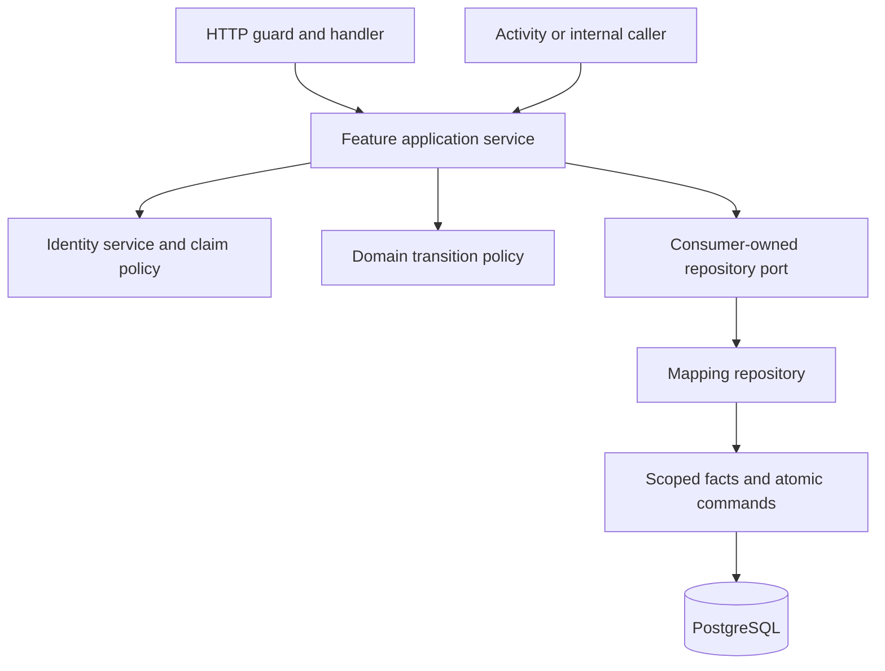

# Service policy and atomic persistence

Application services decide whether a use case is allowed, which information it
may disclose, and which business transition it requests. Domain policies express
those decisions as functions of facts. Repositories translate domain values and
persistence records. Data sources load scoped facts and apply explicit commands
atomically. They do not select claims or evaluate authority.

This guide extends [domain structure](domain-structure.md),
[dependency injection](dependency-injection.md), [identity](identity.md) and
[HTTP presentation](http-presentation.md). The
[service-policy architecture tests](../../../backend/tests/architecture/service_policy_test.go)
reject selected boundary regressions. The [code pattern map](../code-patterns.md)
links the wider conventions and their checks.

## Responsibility and entry points

| Boundary | Responsibility |
| --- | --- |
| Route and HTTP guard | Parse credentials, authenticate, require coarse endpoint claims, and reject malformed transport input. |
| Identity service | Interpret session, membership, credential and retained-consent identity facts; complete permissions using one claim catalog and evaluator. |
| Feature service | Select claims, authorize foreground and background operations, choose disclosure, validate business state and produce transition commands. |
| Domain policy | Compute product rules such as metadata merge, admission limits, evidence precedence and lifecycle outcomes from typed facts. |
| Repository | Map facts, query options, explicit commands, results and storage conflicts. |
| Data source | Perform scoped I/O and atomic compare-and-write, enforce uniqueness and relational integrity, and retain lease, generation and transaction ownership. |
| Workflow and activity | Workflow performs deterministic orchestration; activity calls an injected service. Preserve recorded workflow commands and payloads. |

Handlers, activities, dispatchers and cross-domain consumers receive service
ports. Each consumer owns its small interface. Core does not import another
domain's concrete service or any SQL/HTTP infrastructure. Bootstrap connects the
implementations. Services use named repository fields and explicit methods;
embedding a repository would expose unchecked promoted methods.

## Fresh authority and disclosure

A feature declares a consumer-owned authority port with the methods it needs:

- `ResolveAuthority(ctx, principal)` loads current session and identity facts. It
  ignores caller-provided roles, ownership, grants and permission lists, verifies
  account/user/session binding and credential revision, and rejects expired or
  revoked sessions, disabled memberships and unfinished password changes.
- `ResolveBackgroundAuthority(ctx, accountID, userID, credentialRevision)` checks
  a persisted consent identity without inventing a bearer session. Its retained
  revision must be positive and current. Logout does not by itself revoke stored
  consent. Credential changes, disabled membership, password requirements or lost
  required claims can stop the background use case.

Returned principals contain permissions from the existing identity evaluator.
`HasPermission` is a membership check on that completed result, not a way to trust
an arbitrary principal from a caller. The feature selects required claims and
maps identity errors to its established public errors. For example, a forbidden
import may be represented differently from an invalid HTTP session.

An operation's main claim does not authorize every field. Document Jobs chooses
whether titles are included separately from permission to read job history.
Personal activity computes document, email, batch and title scopes for every
membership, with a bounded membership read. Chat checks required search/read/OCR
claims and retained source existence before provider disclosure and completion.
System settings authority never supplies access to private namespace content.

Repositories receive account/owner scope and explicit projection values. SQL
retains those filters, including matching requested resource IDs to scope. A
`system` flag is an explicit query choice made after service authorization; it
must never be accepted as proof of permission by a service.

## Operation boundaries and revocation

Ordinary reads authorize at the service-operation boundary. Revocation committed
before the authority snapshot is effective. An operation already authorized may
finish. Its later content query can see content committed after that snapshot.
This deliberately replaces the older requirement that authority and content
always share one repeatable-read transaction. It does not promise to abort every
in-flight request when membership changes.

The page and count still share one read-only snapshot. Each later service call
loads fresh authority. Activity account scopes are resolved before querying the
feed; a permitted in-flight feed can finish after a membership is revoked, while
the next operation excludes that membership. No broad identity row locks are
needed for these reads.

Long operations reauthorize at meaningful stages, especially after streaming or
remote I/O and before acceptance or disclosure. Background identity comes from
stored provider/run/item/turn facts, not caller-selected account/user fields.
Document imports retain provider consent revision and work fences at acceptance.
Chat renews authority for retained evidence as work progresses. Cancellation,
owner, generation, attempt and lease predicates are checked atomically when
storage accepts the command.

Realtime retains its coherent authority snapshot: the source returns raw session
and membership facts and the service validates them and selects topics before
anything is emitted. A feature that needs another shared authority/content
snapshot should use a narrow facts-and-result read and decide before disclosure.
Do not expose a transaction to core or invoke a service callback inside SQL.

## Decisions and concurrent writes

A service-side check followed by an unconditional write is unsafe. Use:

1. Read the decision facts through a scoped repository operation.
2. Decide in the service or pure domain policy.
3. Submit the requested change together with the observed facts.
4. Compare the expected facts in one source-owned transaction and either commit
   all effects or reject the stale command.
5. Where retry is appropriate, reload and decide again with a bounded retry.

Identity writes retain installation and ordered account/user/membership/session
locks where required. The source compares the actor's role, system role,
ownership, grants, enabled/password state, credential revision and session facts.
Membership updates also compare their target. Invitation acceptance compares the
issuer and invitation facts, checks the expiry fence and recipient absence, then
inserts membership and consumes the invitation together. Administrator changes
compare the complete administrator identity set under the installation lock.
The service decides first/final-administrator rules; counting outside that atomic
comparison would permit concurrent invariant violations.

Full-fact comparisons avoid a schema change where the existing facts suffice.
Use an explicit aggregate revision when they do not. A stale-fact conflict means
the command's assumptions changed; the data source must not interpret it as a new
permission decision. Public services map or retry it deliberately.

Quota enforcement remains one atomic count-and-create operation using a
service-supplied limit. Scheduler admission retains one coordinated reservation
for the complete required resource vector. Sources do not independently choose
a different limit or grant a partial reservation. Settings reads remain
nonmutating; expected revision and capacity facts guard settings writes.

Outbox intent, accepted documents, related links and counters remain in their
existing transactions. Do not split duplicate recovery, file publication or
unknown Temporal execution ownership merely to move a policy function. Preserve
idempotency, generation/OCR/attempt fences, stable registration names, payloads,
command order and retention horizons.

## Rules that remain in adapters

Parameterized SQL, joins, account/owner predicates, pagination, mapping,
uniqueness, expected-state predicates, savepoints, leases and narrow locks are
persistence responsibilities. Efficient ranking and oldest-feasible scheduler
queries may implement documented domain policy in SQL. They do not require
loading all candidates into a service.

Protocol parsing, bounded XML/JSON/MIME/IMAP decoding, network destination
restrictions, encryption and atomic file publication remain adapter work.
Product acceptance, consent renewal, credential retention, invoice evidence,
metadata precedence and terminal outcomes belong in services/domain policy.
Classify each mixed function by its decision; moving its constants alone does
not transfer its orchestration responsibility.

Do not replace these boundaries with services injected into data sources,
service callbacks inside transactions, transactions hidden in context, a generic
repository framework or an implicit permission bypass for workers.

## Enforcement and validation

Architecture checks reject claim strings, authority-evaluator dependencies and
calls, and application transition-planner calls in feature repositories/data
sources. They also reject repository embedding in production services.
Existing import and naming checks remain in force. Source checks cannot prove
semantic ownership or atomicity, so service tests use permissive storage doubles
to demonstrate denial before I/O, and PostgreSQL tests exercise real races.

Keep regression coverage for tenant/private scopes, optional disclosure,
revocation at long-running stages, quotas, invitation consumption, administrator
races, lease/generation/revision fencing, outboxes, scheduler reservations and
nonblocking ordinary reads. Use isolated test schemas and workflow queues. Record
actual commands and results in the implementation plan and progress records.
