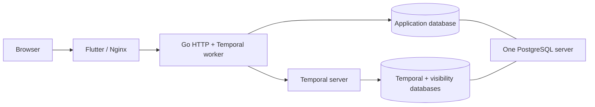

# Compose deployment and development infrastructure

For a small home installation with one admitted ingestion job, start with four
CPU cores and 5 GiB available RAM, plus memory for Ollama models and host
overhead. Search embeddings use Ollama even when optional AI is disabled. See
[runtime resources and memory diagnosis](resources.md) for per-service
ceilings, Go soft limits, overrides and OOM measurements.

## Start the complete application

Install Docker with Compose v2 or newer and start the Docker daemon, then run
from the checkout:

```sh
docker compose up --build --wait
```

Open **http://localhost:8088** and create an account. No default application credentials are seeded. Docker builds the Go binaries and Flutter web assets; Go, Flutter, Java, Bun and Task are not host prerequisites. The initial Flutter SDK download is approximately 1.58 GB. Its verified Linux archive is AMD64-only, so ARM64 hosts need Docker's AMD64 emulation for that build stage. Runtime images support both architectures. The [Compose file](../../compose.yaml) pins runtime images, and the [frontend Dockerfile](../../frontend/Dockerfile) pins the Flutter archive and its checksum.

On an installation without users, accounts or documents, the first successful
registration becomes system administrator. Later users receive their own libraries.
An existing installation is never assigned an administrator automatically. If it
has no administrator, explicitly choose an existing user with
`docker compose exec backend /app/bootstrap-admin --user-id USER_UUID`.
The command refuses once an administrator exists. System administrators can then
promote other users through the app; they do not receive those users' documents.

The web container serves Flutter and proxies `/api/`, `/healthz` and `/readyz` to Go. Flutter uses the browser's current origin, so the image also works at another hostname. The Go process serves HTTP and polls Temporal task queues in the same process. There is no separate application worker container.



Initialization is ordered and repeatable: PostgreSQL becomes healthy; the Bun database initializer provisions separate application and Temporal roles/databases; matching Temporal tools apply persistence and visibility schemas; Temporal passes a real gRPC health probe; the configured namespace is created/verified; the Go worker/API becomes ready; web becomes healthy. Initialization failures stop dependent startup.

Temporal uses the official `temporalio/server:1.32.0` image pinned by digest.
Its container health check probes the listening port. The existing initializer
then waits for real gRPC cluster health before creating or verifying the namespace.
Backend readiness continues checking Temporal and its namespace during operation.
`DYNAMIC_CONFIG_FILE_PATH=/dev/null` selects no dynamic overrides. Administrative
CLI commands run from the existing initializer image; there is no custom Temporal
server image to build or publish. Existing database volumes and schemas are unchanged.

## Ports and commands

Published ports bind to `127.0.0.1` by default. Go is reached through the web proxy in the packaged stack; its container port is not published.

| Service | Host port | Setting |
| --- | --- | --- |
| Web and proxied API | 8088 | `WEB_PORT` |
| PostgreSQL | 54329 | `POSTGRES_PORT` |
| Temporal gRPC | 7233 | `TEMPORAL_PORT` |
| Private document processor | 8091 | `DOCUMENT_PROCESSOR_PORT` |
| Temporal UI | 8233 | `TEMPORAL_UI_PORT` |

```sh
# Start the application and Temporal UI at http://localhost:8233.
docker compose up --build --wait

# Inspect service health and logs.
docker compose ps
docker compose logs --tail 100 backend temporal

# Stop and remove containers/network, keeping database/workflow data.
docker compose down
```

`task compose:up` and `task compose:down` expose the same full-stack lifecycle through Go Task and Bun. `task infra:up` starts PostgreSQL, Temporal and its UI, the private document processor, Ollama and initialization jobs; `task infra:down` stops infrastructure. `task db:down` stops only PostgreSQL. Ordinary commands do not remove volumes. Infrastructure shutdown makes a running API unready; stop the application first when ending a session.

Run `task dev` for native Air and Flutter hot reload against Compose infrastructure. Stop the packaged backend before starting a native worker on the same queue: otherwise both processes can poll it. `docker compose stop web backend` leaves infrastructure available for development. All workers on a queue must use the same application database/schema and compatible workflow code.

## Select the development Ollama runtime

Change this one line in `backend/.env`, then restart `task dev`:

```dotenv
OLLAMA_RUNTIME=mlx
```

| Value | Runtime | Host requirement |
| --- | --- | --- |
| `cpu` | Default pinned Ollama Docker image | Docker |
| `cuda` | Same image with the CUDA override | NVIDIA GPU, driver and NVIDIA Container Toolkit |
| `rocm` | Pinned ROCm image with AMD device mappings | Supported AMD GPU and Linux ROCm driver |
| `mlx` | Pinned native Ollama with its MLX engine | Apple Silicon Mac and Docker with host gateway access |

The checked-in default is `cpu`. An exported `OLLAMA_RUNTIME` takes precedence;
for example, `OLLAMA_RUNTIME=cuda task dev` selects CUDA for one run. Unknown
values and unsupported MLX hosts fail before infrastructure starts. CUDA and
ROCm still require their hardware and drivers; the selector does not install them.

MLX downloads and verifies the official Ollama 0.34.1 macOS archive on first use
(about 159 MB), then reuses `.cache/tools/ollama/0.34.1`. No system Ollama install
is needed. It serves the existing `http://127.0.0.1:11435` origin and keeps models
in `.cache/ollama/models`. The launcher owns this process, stops it after Go and
Flutter drain, and stops it on failed startup. It does not reuse another Ollama
daemon. An unrelated listener on that port produces an error. To change the
port, update both `LLM_OLLAMA_PORT` and the matching loopback `LLM_OLLAMA_URL`.
The launcher manages `OLLAMA_HOST` and `OLLAMA_MODELS` itself.

The processor remains in Docker. The MLX override omits container Ollama, mounts
the native cache read-only, and connects through `host.docker.internal`. Docker
must share the checkout and reach the host's loopback listener through that name;
startup checks this before starting the rest of the infrastructure. Remote Docker
daemons cannot use this local native mode. The launcher stops the project's
previous processor and Ollama containers when entering MLX mode. Both the Docker
model volume and native cache survive switching runtimes and ordinary shutdown;
each cache may need its own initial model download. Docker memory limits do not
apply to native Ollama.

Select **Internal Ollama** and an MLX-compatible model, such as
`gemma4:12b-mlx`, in **Admin → Document processing** to use MLX for property or
invoice extraction. The first job downloads that model; size and memory needs
depend on the selected model. Existing saved model choices are preserved.
The pinned Nomic embedding model remains in its original format and uses
Ollama's compatible engine, so changing the runtime does not change the embedding
space or bypass manifest and blob verification. See
[Ollama's MLX guide](https://ollama.com/blog/mlx-performance) and
[available Gemma model tags](https://ollama.com/library/gemma4/tags).

`task infra:up` uses the same selector. With MLX it stays in the foreground to
own native Ollama; keep that terminal open and use
`task dev -- --external-services` in another terminal. Ctrl+C stops native
Ollama; `task infra:down` stops the retained Docker containers without deleting
volumes. Stop the development session before switching runtimes.

`OLLAMA_RUNTIME` applies to development launchers. `task compose:up`, direct
`docker compose up --build --wait`, disposable test harnesses and `task test:all`
keep their Docker baseline. Use the explicit CUDA/ROCm Compose overrides for
packaged deployments. `compose.mlx.yaml` is a development override used by the
native launcher, not a standalone deployment.

## Configuration and persistence

`backend/.env` is intentionally checked in with public development credentials.
The literal defaults in Compose match it, so the direct one-command startup works
for local evaluation. Keep these defaults in version control; keep deployment
passwords in exported settings or a private ignored file. For local development,
Task/Bun helpers read `backend/.env` automatically, with exported overrides.

### Private deployment settings

For a **fresh installation**, create `.env.deployment.local` in the checkout
root with three distinct generated passwords. The following optional recipe
requires a POSIX shell and OpenSSL; it writes the passwords directly to a private
file without printing them. It refuses to overwrite an existing file and stops
if password generation fails. Alternatively, use a password manager to generate
three separate 64-character hexadecimal passwords and save the same three
variable names in that private file.

```sh
(
  umask 077
  set -eu
  set -C
  admin_password="$(openssl rand -hex 32)"
  app_password="$(openssl rand -hex 32)"
  temporal_password="$(openssl rand -hex 32)"
  printf 'POSTGRES_ADMIN_PASSWORD=%s\nPOSTGRES_PASSWORD=%s\nTEMPORAL_DB_PASSWORD=%s\n' \
    "$admin_password" "$app_password" "$temporal_password" > .env.deployment.local
  chmod 600 .env.deployment.local
)
```

These settings supply the provisioning administrator, Domabas database role and
Temporal database role respectively. For an existing database, retain the current
credentials; changing the administrator setting does not rotate its stored
password. Plan administrator password rotation in PostgreSQL separately;
changing this file alone is insufficient.

Edit only the private file to add deployment settings, such as
`CORS_ORIGINS=http://192.168.0.230:8088` with your actual browser origin.
HTTP works directly on the published web port. To use HTTPS, configure a proxy
separately and use its HTTPS origin. Keep `BIND_ADDRESS=127.0.0.1` and
`PRIVATE_BIND_ADDRESS=127.0.0.1` in the private file. Changing `BIND_ADDRESS`
also exposes PostgreSQL, Temporal and Temporal UI; use the
[web-only override](#allow-web-access-from-another-machine) for remote web access.
Compose supplies internal service addresses and passes `POSTGRES_PASSWORD` to
the backend as `PGPASSWORD`; no deployment `DATABASE_URL` needs to be copied from
the development file.

Use the private file explicitly for every Compose command, including later
updates and shutdown:

```sh
git check-ignore .env.deployment.local
docker compose --env-file .env.deployment.local config --quiet
docker compose --env-file .env.deployment.local up --build --wait
docker compose --env-file .env.deployment.local ps
docker compose --env-file .env.deployment.local down
```

The explicit `--env-file` replaces Compose's automatic `.env` lookup. Exported
variables still override that file, so clear stale exported settings before
deployment. Task/Bun helpers continue to use the development file; they do not
select `.env.deployment.local`. See
[Docker's interpolation rules](https://docs.docker.com/compose/how-tos/environment-variables/variable-interpolation/).
`config --quiet` checks syntax without printing the resolved credentials; it
does not verify password strength or deployment readiness.

The private env file and `*.local.yaml` / `*.local.yml` deployment copies are
ignored by Git and excluded from Docker build contexts. Do not force-add them or
attach completed files or resolved Compose output to issues. Keep any backups
of these files private too. For standalone TrueNAS YAML, follow the
[private-copy workflow](../../truenas/README.md#3-fill-in-your-settings).

### Allow web access from another machine

For a trusted LAN, keep both bind settings above on loopback and save this as
`compose.web.local.yaml`. Replace `192.168.0.230` with the Docker host's LAN
address and set `CORS_ORIGINS=http://192.168.0.230:8088` in
`.env.deployment.local` to match your address and web port.

```yaml
services:
  web:
    ports: !override
      - "192.168.0.230:${WEB_PORT:-8088}:8080"
```

This requires Docker Compose 2.24.4 or newer. The
[`!override` tag](https://docs.docker.com/reference/compose-file/merge/#replace-value)
replaces the web port mapping instead of appending another one. PostgreSQL,
Temporal, Temporal UI, Ollama and the processor keep their loopback bindings.
The backend remains reachable through the web proxy without its own host port.

Use both files for every command, including shutdown:

```sh
git check-ignore .env.deployment.local compose.web.local.yaml
docker compose --env-file .env.deployment.local -f compose.yaml -f compose.web.local.yaml config --quiet
docker compose --env-file .env.deployment.local -f compose.yaml -f compose.web.local.yaml up --build --wait
docker compose --env-file .env.deployment.local -f compose.yaml -f compose.web.local.yaml ps
docker compose --env-file .env.deployment.local -f compose.yaml -f compose.web.local.yaml down
```

Ordinary `down` retains the data volumes. HTTP sends credentials and sessions
without encryption; for HTTPS, place a TLS proxy in front of the web endpoint
and set `CORS_ORIGINS` to its exact HTTPS origin. A proxy running on the Docker
host can reach the default loopback web port without this LAN override.

### Persistent data

Container connections use service DNS (`postgres`, `temporal`), while native
tools use published localhost ports. If changing a native port, update its
`DATABASE_URL` or `TEMPORAL_ADDRESS` too. For another machine's web access, use
the [web-only override](#allow-web-access-from-another-machine) and configure TLS
termination for credentials and sessions.

Configure `OLLAMA_MAX_QUEUE=128` consistently on Ollama, backend replicas and the processor, then use Admin settings → Workload limits to adjust worker, Ollama and external-provider capacity. The shared Ollama background budget is at most 64 jobs and defaults to one. Worker capacity defaults to ten jobs, and external provider origins to two. Running requests are never cancelled merely because ingestion arrives. The former `DOCUMENT_INGESTION_CONCURRENCY` and `DOCUMENT_AI_CONCURRENCY` settings no longer control admission. An external Ollama queue cannot be discovered through its API; configure its matching budget explicitly. Actual computation still depends on model parallelism and the processor’s ten OCR slots.
The processor image stages waiting originals in private disk-backed `/app/tmp`;
allow enough Docker disk space for accepted originals and active OCR scratch.
That location is separate from the 2 GiB `/tmp` tmpfs and from persistent original
and database volumes. Normal requests clean up their files; recreating a stopped
processor container discards scratch left by a hard crash.

Admin settings → Workload limits shows shared capacity and active reservations.
Changing capacity does not reindex documents. Lowering it lets running jobs finish
before new work uses the smaller budget. The oldest waiting job whose complete
resource requirements fit gets the next available capacity. Running model requests
continue when new ingestion arrives. See [resource scheduling](../arch/backend/resource-scheduler.md).

PostgreSQL uses a named `postgres_data` volume mounted at the PostgreSQL 18 root `/var/lib/postgresql`. Three databases hold application metadata, Temporal persistence and Temporal visibility. The administrative bootstrap role (`POSTGRES_ADMIN_USER`/`POSTGRES_ADMIN_PASSWORD`) creates the separate application and Temporal roles. Neither runtime role needs superuser or database-creation privileges. The schema job uses the Temporal role only to manage its own tables.

The pinned `pgvector/pgvector:0.8.6-pg18-trixie` image contains PostgreSQL 18.6.
It retains the existing PostgreSQL 18 data directory and volume mount. The updated
database initializer installs `vector` 0.8.6 in the application's `public` schema
as the database administrator, including on retained volumes. Migration 029 then
builds an HNSW expression index from existing embedding arrays. It preserves the
arrays, text, model identifiers, generations and unfinished jobs; no embeddings
are regenerated. The application role does not require superuser privileges.

For an upgrade, use the matching PostgreSQL, initializer, backend and web images
from the new release Compose file. Updating only the backend image on an older
TrueNAS Compose file is insufficient. Keep the current dataset/volume and mount
path. Take the normal database backup and stop the old backend worker before
starting the upgraded backend. The index build runs transactionally and blocks
chunk writes until it finishes; allow for startup time proportional to the indexed
data. Startup migrations and `task db:migrate` allow up to ten minutes. A failed
build rolls back and can be retried; it does not leave an invalid partial index.
Very large installations may need a separately planned concurrent index build.

For externally managed PostgreSQL, install the pgvector 0.8.6 server binaries for
PostgreSQL 18 and run `CREATE EXTENSION vector WITH SCHEMA public VERSION '0.8.6'`
in the application database as its administrator before starting the new backend.
The migration fails clearly if the extension is missing or incompatible.

Application migration 013 installs PostgreSQL's bundled trusted `pg_trgm` 1.6
extension in `public`. The existing application database owner can install it;
an externally managed restricted migration role needs database `CREATE` authority
or an operator-installed extension with this version and schema. The migration
does not relocate or upgrade an existing incompatible installation. CI runners
need the same PostgreSQL 18.6 bundled extension. Disposable test schemas reuse it
and never remove it during cleanup. No new image or package download is required.

Document originals use separate `document_ingestion` and `document_storage`
volumes mounted at `/data/ingestion` and `/data/documents`. Each contains namespace,
uploader and document UUID directories. To map host folders, replace these two
volume entries with bind mounts owned by UID/GID 65532, mode 0700. The roots must
be separate, owned and not group/world writable. Back up these folders together
with PostgreSQL. Native Go defaults use `.cache/ingestion` and `.cache/documents`;
`DOCUMENT_INGESTION_ROOT` and `DOCUMENT_STORAGE_ROOT` override them.

Paperless import needs no environment setup. Each user enters their source URL
and API token in Settings. The backend automatically creates a private encryption
key in the `credential_keys` volume at `/var/lib/domabas/secrets/paperless.key`.
This volume survives container recreation and ordinary down/up. Back it up along
with PostgreSQL so active imports can resume. Replicas using one database must
share this key. Existing deployments can retain the optional
`PAPERLESS_CREDENTIAL_KEY` environment override. See the
[Paperless guide](../arch/backend/paperless-import.md) for the key lifecycle.

Email accounts also need no key setup. A separate private key is generated at
`/var/lib/domabas/secrets/email.key` in the same retained `credential_keys` volume.
Keep both files with installation backups and share them between backend replicas.
The optional `EMAIL_CREDENTIAL_KEYS` and `EMAIL_CREDENTIAL_ACTIVE_KEY_ID` settings
still override automatic email key management. See the
[email guide](email.md) for recovery and rotation.

The processor builds Tesseract 5.5.3 and Leptonica 1.87.0 from verified sources.
On first start it downloads checked English/German OCR weights and Nomic Embed
Text v1.5, verifies their hashes and warms CPU inference. `tesseract_models` and
`ollama_models` retain caches across ordinary shutdown. The official Ollama image
is a large initial download; allow several GB of disk and sufficient Docker
memory for the processor’s 4 GiB limit and Ollama’s 8 GiB limit in addition to
the application stack. Each inference container defaults to a four-CPU quota.
Override `DOCUMENT_PROCESSOR_CPUS`, `DOCUMENT_PROCESSOR_MEMORY_LIMIT`,
`OLLAMA_CPUS` and `OLLAMA_MEMORY_LIMIT` when sizing the host. The processor has
ten extraction slots and `max(1, floor(OLLAMA_MAX_QUEUE / 2))` embedding slots.
Ollama permits two loaded models
for optional property extraction alongside embeddings. Its queue defaults to 128
requests, configurable with `OLLAMA_MAX_QUEUE`;
its pinned embedding runtime processes inference in one slot regardless of
`OLLAMA_NUM_PARALLEL`, which remains one. The shared resource scheduler admits background jobs across all backend replicas. Set limits in administrator Workload settings, keeping the Ollama total at or below half its configured queue. Leave headroom for semantic queries and unrelated clients. Email and Paperless share worker permits but do not reserve Ollama during retrieval. Actual throughput depends on CPU, memory and model
capacity, not queue length. Model calls have no fixed HTTP deadline; new
workflows wait while their worker heartbeats. OCR execution and health deadlines
remain. Temporal requires a finite activity deadline, set to ten years for model
stages and new extraction activities so CPU queue waiting can continue.
Stop all backend workers when upgrading migration 020 and rebuild the private
processor so neither hop retains the previous embedding timeout. Already started
executions retain their old deadlines; retry failed jobs after the upgrade.
Missing Temporal history retains unlimited execution reservations for operator
investigation instead of silently freeing potentially active capacity.
The processor startup budget is ten minutes; Task wrappers allow fifteen minutes
for infrastructure readiness. Complete retained caches start without downloading
again. Corrupt caches fail readiness rather than silently selecting another model.

Ollama and the processor use `PRIVATE_BIND_ADDRESS`, independently of
`BIND_ADDRESS`; its default is `127.0.0.1`. Keep it on loopback for these private
endpoints. `LLM_OLLAMA_PORT` selects Ollama's host port (default 11435).
Native development uses
`DOCUMENT_PROCESSOR_URL=http://127.0.0.1:8091`; adjust that URL when changing
`DOCUMENT_PROCESSOR_PORT`. These private inference endpoints have no account
authentication and must stay private. System administrators configure supported
OCR language and segmentation through `/api/v1/system/document-processing`.
For a packaged deployment without native host clients, remove the processor's
`ports` entry; the backend continues using the private service address.
See [document ingestion](../arch/backend/document-ingestion.md) for API limits,
model provenance, semantic search capacity and current English semantic scope.

The processor accepts source images up to 50 million pixels. PDF rendering uses
up to 200 DPI, reducing DPI for oversized pages to stay within a 50-million-pixel
bitmap budget. Compose defaults to four CPUs, 4 GiB of memory and a 2 GiB `/tmp` tmpfs.
Use `DOCUMENT_PROCESSOR_MEMORY_LIMIT` and `DOCUMENT_PROCESSOR_CPUS` to size the
container for your host. The tmpfs shares the memory budget; original and OCR
scratch files use the private disk-backed `/app/tmp`. Defaults target one
active document; increase memory when raising the shared worker or Ollama job limit
for large images. OCR allows 120 seconds per Tesseract call and eight minutes per
extraction. Rebuild both backend and processor to apply the matching HTTP and
workflow allowances; retained workflows keep their recorded activity deadlines.

The default admin credentials initialize a **fresh** volume. Changing them does not change an existing PostgreSQL administrator's password. Application and Temporal role credentials are reapplied by the initializer. Use a deliberate migration/backup process when changing database names or adopting existing data; no startup operation drops or renames databases. If adopting an older Compose volume initialized with the application user as superuser, supply its existing administrator credentials and choose distinct runtime roles. The initializer requires admin, application and Temporal role names to differ.

Earlier repository-native `.cache/postgres` data is retained and not automatically imported into Compose. Stop that server before using the same host port, or choose new ports. To continue using an externally managed database, configure both it and a Temporal namespace, then run `task dev -- --external-services`.

The pinned stack pairs Temporal Server 1.32.0 with PostgreSQL 18.6. Temporal's [published database test matrix](https://docs.temporal.io/temporal-service/persistence#dependency-versions) does not explicitly list PostgreSQL 18. Run `task test:temporal` and `task test:compose` to check schema, workflow and restart behavior before deployment; see the [testing guide](testing.md) for prerequisites.

## Existing document libraries

The identity migration preserves pre-authentication documents without exposing them to new accounts. An operator must explicitly adopt them into the intended existing account; see [identity and adoption](../arch/backend/identity.md). Replace old unscoped backend/worker binaries when upgrading. Browser sessions survive refresh through an HttpOnly cookie; see [session lifetime](../arch/frontend/identity.md).

The namespace migration preserves existing libraries, sessions and membership
flags. The earliest enabled historical owner retains the library as a personal
namespace; other users receive empty personal namespaces while keeping old access.
Deploy the new client and server together for the `admin/user/viewer` role names.
Invitations use a one-time code copied by the issuer and delivered out of band;
this stack does not send email or verify mailbox ownership.

## Exercise the embedded worker

Create a document through the web app or API, copy its UUID, then:

```sh
docker compose exec backend /app/workflow --account-id ACCOUNT_UUID --document-id DOCUMENT_UUID
```

The trusted operator diagnostic requires the account UUID from the authenticated session and starts `domabas.DocumentMetadata.v2`. Its activity reads the persisted document through the injected repository and returns JSON containing only `id` and `createdAt`. Titles/descriptions stay out of workflow history. Missing documents fail without repeated retries; transient storage errors have bounded retries. This is a working queue integration, not an automatic processing step on document creation.

The CLI also supports a caller-selected workflow ID, enqueue-only mode, and waiting for an existing workflow; run `/app/workflow --help` for flags. Workflows have execution deadlines. Use unique IDs for independent diagnostics. For native development run `go run ./cmd/workflow --account-id ACCOUNT_UUID --document-id DOCUMENT_UUID` from `backend/`.

Future document processing that must follow a committed database write needs a transactional outbox and idempotent activities. Do not add an uncoordinated database write followed by a Temporal call and treat it as guaranteed delivery.

## Verification and deployment limits

`task test:compose` builds a separate randomly named stack, checks web/API/workflows and restart behavior, retains diagnostic logs under `.logs/`, and removes only that test's disposable project and volumes. Application integration/E2E tests instead use disposable schemas and unique queues. Normal development volumes and any existing native cluster remain untouched.

This is a persistent single-host baseline for private evaluation and development. It has local authentication and account authorization; public TLS termination, HA and backup policy remain deployment responsibilities. Temporal has explicit no-auth configuration and its administration endpoints/UI must remain on trusted networks. Configure those missing operational features before public or sensitive production use. Native Android/iOS/Linux/Windows packaging remains separate from the Compose web distribution.

## Processing dashboard and rollout

When deploying the concurrency limit of ten, stop backend instances before migration 016
and restart them together with the updated processor and Ollama configuration.
The migration removes obsolete singleton owner columns while preserving all
execution records and job progress. Old backend binaries must not keep running
against the migrated schema. No database or model volume reset is needed.

Compose starts Temporal UI by default at `http://localhost:8233`, selects the
configured `TEMPORAL_NAMESPACE`, and supplies the link shown under
**Admin > Document processing > Temporal dashboard**. `TEMPORAL_UI_PORT` changes
both the published port and the default link. A nonempty `TEMPORAL_UI_URL` overrides the
complete browser-facing HTTP(S) URL for remote browsers or a TLS proxy, for example
`TEMPORAL_UI_URL=http://nas.example.test:8233`. Replace the fictional hostname
`nas.example.test` with your browser-reachable NAS hostname or address. Changing
this URL does not publish the UI port. Keep its binding on loopback and use an
authenticated proxy or SSH tunnel for remote administration; do not broaden
`BIND_ADDRESS` just to expose the dashboard.
A deployment base path is allowed; credentials, query strings and fragments
are rejected.

`task dev` and `task infra:up` also start the UI. Native backends use the same
default link: `http://localhost:8233`, following `TEMPORAL_UI_PORT` when set.
An unset or empty `TEMPORAL_UI_URL` selects this default. Air restarts the backend
when `.env` changes; refresh the processing settings to load the link. TrueNAS
templates provide separate UI port, bind address and browser URL settings in
[their deployment guide](../../truenas/README.md).

The URL is disclosed only to system processing managers. The link does not
provide Temporal authentication or namespace isolation; keep the published UI on
a trusted network or behind an authenticated proxy.

For the first jobs/reindex rollout, stop all pre-feature backend dispatchers
before starting the new backend. Do not run old and new dispatchers concurrently
on a retained database. The migration adopts known and ambiguous executions with
a conservative cutover horizon and drains them through Describe; no database
reset or operator workflow cancellation is required. Upgrade the private document
processor together with the backend because embedding requests/results now carry
the complete expected space and extraction revision. A native development setup
can rebuild only that service with
`docker compose up -d --build --no-deps --wait document-processor`.

Keep Temporal history retention at least 24 hours. The backend checks retention
before granting new start permits as well as at startup/readiness. Application,
PostgreSQL and Temporal hosts must have synchronized clocks within one minute;
the 23-hour-59-minute start retry window relies on that margin. SQL permit times
always come from the database clock. Ordinary Compose shutdown retains every
application, original-file and model-cache volume.

## Live connections

Nginx forwards HTTP/1.1 Upgrade and Connection headers and preserves the full Host.
Twenty-second WebSocket heartbeats keep healthy connections alive through the
existing sixty-five-second proxy timeouts. A TLS-terminating external proxy must
forward Upgrade, preserve Host and configure its exact public HTTPS origin in
CORS_ORIGINS. Do not add wildcard origins or place bearer tokens in URLs.
The backend needs one additional dedicated PostgreSQL connection per process for
LISTEN; account for it outside the request pool when setting database limits.
Monitor `pg_notification_queue_usage()` and listener readiness. An open LISTEN
transaction can retain notifications; a full PostgreSQL notification queue rejects
transactions that publish notifications. The application listener keeps no open
transaction while waiting, but other database clients can still retain the queue.

The Compose smoke test holds a socket longer than sixty-five seconds, verifies
heartbeats and a later mutation hint, and checks closure/reconnection across a
backend restart. Its random Compose project and volumes are disposable; ordinary
development stacks and their retained volumes are not removed.
