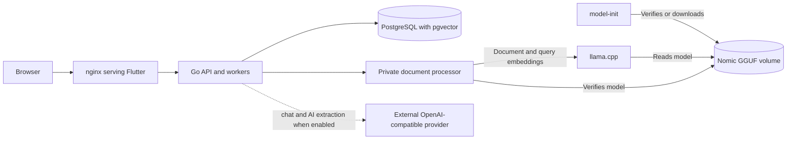

# Compose deployment and development infrastructure

For sizing, see [runtime resources and memory diagnosis](resources.md). The private embedding service runs alongside OCR, including when chat and document AI are disabled.

## Start the complete application

Use Docker Engine 25+ and Compose 2.20.2+ for the root and quick-start files.
These versions support the separate startup health-check interval. TrueNAS
deployments use the [TrueNAS prerequisites](../../truenas/README.md).

The [README quick start](../../readme.md#quick-start) builds this checkout. `compose.quickstart.yaml` includes the sibling root Compose file and uses the same source tree. Release notes provide standalone configurations with first-party images pinned to that release. Keep a release configuration with its associated images. Published Domabas containers target Linux AMD64. Set passwords and network addresses before sharing the installation.

### Build from source

With Docker Compose running, use the root `compose.yaml` from a repository
checkout to build the application:

```sh
docker compose up --build --wait
```

Open **http://localhost:8088** and create an account. No default application credentials are seeded. Docker builds the Go binaries and Flutter web assets; Go, Flutter, Java, Bun and Task are not host prerequisites. The initial Flutter SDK download is approximately 1.58 GB. Its verified Linux archive is AMD64-only, so ARM64 hosts need Docker's AMD64 emulation for that build stage. Runtime images support both architectures. The [Compose file](../../compose.yaml) pins runtime images, and the [frontend Dockerfile](../../frontend/Dockerfile) pins the Flutter archive and its checksum.

On an installation without users, accounts or documents, the first successful
registration becomes system administrator. Later users receive their own libraries.
An existing installation is never assigned an administrator automatically. If it
has no administrator, explicitly choose an existing user with
`docker compose exec backend /app/bootstrap-admin --user-id USER_UUID`.
The command refuses once an administrator exists. System administrators can then
promote other users through the app; they do not receive those users' documents.

The web container serves Flutter and proxies `/api/`, `/healthz` and `/readyz` to Go. Flutter uses the browser's current origin, so the image also works at another hostname. The Go process serves HTTP and polls PostgreSQL job tables in the same process. There is no separate application worker container.



The database initializer provisions the application database, role and pgvector. The backend applies migrations and starts its Go worker when dependencies are ready.

### Health checks

Container health checks run every 30 seconds after startup. Startup checks run
every two to five seconds; the backend and processor allow ten minutes for their
initialization. Three consecutive failures mark a running container unhealthy,
roughly 60–90 seconds after a fault plus the probe durations.

The backend's `/readyz` checks its dependencies, workers, dispatchers and storage
directory metadata. Storage probes do not create, delete or sync files. They do
not test write permissions, free capacity or durability; actual storage operations
report those failures. The web container probes the proxied `/healthz` to check
nginx-to-backend liveness without repeating dependency probes. It still waits for
backend readiness at startup, and public `/readyz` remains available through nginx.

Recreating containers applies YAML health-check intervals. Read-only storage
readiness and reduced dispatcher health calls require a backend image built from
this source; changing YAML does not change the implementation inside a pinned
published image. Keep coordinated application image versions when upgrading.

## Ports and commands

Published ports bind to `127.0.0.1` by default. Go is reached through the web proxy in the packaged stack; its container port is not published.

| Service | Host port | Setting |
| --- | --- | --- |
| Web and proxied API | 8088 | `WEB_PORT` |
| PostgreSQL | 54329 | `POSTGRES_PORT` |
| Private document processor | 8091 | `DOCUMENT_PROCESSOR_PORT` |

```sh
# Start the source checkout.
docker compose up --build --wait

# Inspect service health and logs.
docker compose ps
docker compose logs --tail 100 backend

# Stop and remove containers/network, keeping database/workflow data.
docker compose down
```

From a checkout, use `docker compose up --build --wait` to build and start the
current source. `task compose:up` and `task compose:down` manage the full stack. `task infra:up` starts PostgreSQL, the model initializer, the private embedding server and the document processor and initializes the database. `task infra:down` stops infrastructure and retains data. `task db:down` stops PostgreSQL. Stop the application before stopping its dependencies.

Run `task dev` for native Air and Flutter hot reload against Compose infrastructure. Stop the packaged backend before starting a native worker on the same queue: otherwise both processes can poll it. `docker compose stop web backend` leaves infrastructure available for development. All workers on a queue must use the same application database/schema and compatible workflow code.

## Select the embedding runtime

CPU embeddings are the default. To use Vulkan on Linux, select an accessible render node with a compatible Vulkan driver. Obtain its numeric group using `stat -c %g /dev/dri/renderD128`. Configure `VULKAN_RENDER_DEVICE` and `VULKAN_RENDER_GROUP` for the node and group you intend to expose. The defaults are `/dev/dri/renderD128` and `107`.

```sh
docker compose -f compose.yaml -f compose.vulkan.yaml up --build --wait
docker compose logs embeddings
```

Look for the expected Vulkan device and offloaded model layers in the server logs. The CPU and Vulkan images are pinned to the same llama.cpp build, b12464. Each serves only the verified 274,290,560-byte Nomic v1.5 F16 GGUF. The embedding server has no published host port.

For hot reload or managed infrastructure use `EMBEDDING_RUNTIME=vulkan task dev` or `EMBEDDING_RUNTIME=vulkan task infra:up`. Set `EMBEDDING_RUNTIME=cpu` to return to CPU processing. Direct Compose deployments select the override file explicitly. For TrueNAS see [the deployment templates](../../truenas/README.md).

### Upgrade an installation with the previous inference service

Use the old Compose configuration to stop the stack with `docker compose down`, preserving its volumes. Keep the same Compose project name, file-storage volumes, database and credential keys when starting the new configuration. Stopping the old stack also releases the previous model server's memory. Its former model-cache volume can remain in place.

On first startup the model initializer creates the verified GGUF cache. The backend adopts a new embedding-space identity and queues retained originals for reindexing. Lexical search continues to work while new semantic results become available. Existing external AI settings remain usable. For a previous internal AI configuration, enter an external destination and model in the corresponding administrator settings and explicitly enable the feature.

## Configuration and persistence

`backend/.env` is intentionally checked in with public development credentials.
The literal defaults in Compose match it, so the direct one-command startup works
for local evaluation. Keep these defaults in version control; keep deployment
passwords in exported settings or a private ignored file. For local development,
Task/Bun helpers read `backend/.env` automatically, with exported overrides.

### Private deployment settings

For a **fresh installation**, create `.env.deployment.local` in the checkout
root with three distinct generated passwords. The following optional recipe
requires a POSIX shell and OpenSSL; it writes the passwords directly to a private
file without printing them. It refuses to overwrite an existing file and stops
if password generation fails. Alternatively, use a password manager to generate
two separate 64-character hexadecimal passwords and save the same two
variable names in that private file.

```sh
(
  umask 077
  set -eu
  set -C
  admin_password="$(openssl rand -hex 32)"
  app_password="$(openssl rand -hex 32)"
  printf 'POSTGRES_ADMIN_PASSWORD=%s\nPOSTGRES_PASSWORD=%s\n' \
    "$admin_password" "$app_password" > .env.deployment.local
  chmod 600 .env.deployment.local
)
```

These settings supply the provisioning administrator and Domabas database role respectively. For an existing database, retain the current
credentials; changing the administrator setting does not rotate its stored
password. Plan administrator password rotation in PostgreSQL separately;
changing this file alone is insufficient.

Edit only the private file to add deployment settings, such as
`CORS_ORIGINS=http://192.168.0.230:8088` with your actual browser origin.
HTTP works directly on the published web port. To use HTTPS, configure a proxy
separately and use its HTTPS origin. Keep `BIND_ADDRESS=127.0.0.1` and
`PRIVATE_BIND_ADDRESS=127.0.0.1` in the private file. Changing `BIND_ADDRESS`
also exposes PostgreSQL; use the
[web-only override](#allow-web-access-from-another-machine) for remote web access.
Compose supplies internal service addresses and passes `POSTGRES_PASSWORD` to
the backend as `PGPASSWORD`; no deployment `DATABASE_URL` needs to be copied from
the development file.

Use the private file explicitly for every Compose command, including later
updates and shutdown:

```sh
git check-ignore .env.deployment.local
docker compose --env-file .env.deployment.local config --quiet
docker compose --env-file .env.deployment.local up --build --wait
docker compose --env-file .env.deployment.local ps
docker compose --env-file .env.deployment.local down
```

The explicit `--env-file` replaces Compose's automatic `.env` lookup. Exported
variables still override that file, so clear stale exported settings before
deployment. Task/Bun helpers continue to use the development file; they do not
select `.env.deployment.local`. See
[Docker's interpolation rules](https://docs.docker.com/compose/how-tos/environment-variables/variable-interpolation/).
`config --quiet` checks syntax without printing the resolved credentials; it
does not verify password strength or deployment readiness.

The private env file and `*.local.yaml` / `*.local.yml` deployment copies are
ignored by Git and excluded from Docker build contexts. Do not force-add them or
attach completed files or resolved Compose output to issues. Keep any backups
of these files private too. For standalone TrueNAS YAML, follow the
[private-copy workflow](../../truenas/README.md#3-fill-in-your-settings).

### Allow web access from another machine

For a trusted LAN, keep both bind settings above on loopback and save this as
`compose.web.local.yaml`. Replace `192.168.0.230` with the Docker host's LAN
address and set `CORS_ORIGINS=http://192.168.0.230:8088` in
`.env.deployment.local` to match your address and web port.

```yaml
services:
  web:
    ports: !override
      - "192.168.0.230:${WEB_PORT:-8088}:8080"
```

This requires Docker Compose 2.24.4 or newer. The
[`!override` tag](https://docs.docker.com/reference/compose-file/merge/#replace-value)
replaces the web port mapping instead of appending another one. PostgreSQL,
The private processor retains its loopback binding and the embedding server stays on the Compose network.
The backend remains reachable through the web proxy without its own host port.

Use both files for every command, including shutdown:

```sh
git check-ignore .env.deployment.local compose.web.local.yaml
docker compose --env-file .env.deployment.local -f compose.yaml -f compose.web.local.yaml config --quiet
docker compose --env-file .env.deployment.local -f compose.yaml -f compose.web.local.yaml up --build --wait
docker compose --env-file .env.deployment.local -f compose.yaml -f compose.web.local.yaml ps
docker compose --env-file .env.deployment.local -f compose.yaml -f compose.web.local.yaml down
```

Ordinary `down` retains the data volumes. HTTP sends credentials and sessions
without encryption; for HTTPS, place a TLS proxy in front of the web endpoint
and set `CORS_ORIGINS` to its exact HTTPS origin. A proxy running on the Docker
host can reach the default loopback web port without this LAN override.

### Persistent data

Container connections use service DNS (`postgres`), while native
tools use published localhost ports. If changing a native port, update its
`DATABASE_URL` too. For another machine's web access, use
the [web-only override](#allow-web-access-from-another-machine) and configure TLS
termination for credentials and sessions.

Set `EMBEDDING_QUEUE_SIZE` consistently on backend replicas and the processor. The default budget of 128 allows a maximum of 64 background embedding jobs. **Workload limits** controls actual admission. Worker capacity defaults to ten, background embeddings to one and external provider origins to two. External generation and local embedding capacity are independent.
The processor image stages waiting originals in private disk-backed `/app/tmp`;
allow enough Docker disk space for accepted originals and active OCR scratch.
That location is separate from the 2 GiB `/tmp` tmpfs and from persistent original
and database volumes. Normal requests clean up their files; recreating a stopped
processor container discards scratch left by a hard crash.

Admin settings → Workload limits shows shared capacity and active reservations.
Changing capacity does not reindex documents. Lowering it lets running jobs finish
before new work uses the smaller budget. The oldest waiting job whose complete
resource requirements fit gets the next available capacity. Running model requests
continue when new ingestion arrives. See [resource scheduling](../arch/backend/resource-scheduler.md).

PostgreSQL uses a named `postgres_data` volume mounted at the PostgreSQL 18 root `/var/lib/postgresql`. The application database holds metadata, checkpoints and queue state. The administrative bootstrap role (`POSTGRES_ADMIN_USER`/`POSTGRES_ADMIN_PASSWORD`) initializes the application database and its unprivileged runtime role.

The pinned `pgvector/pgvector:0.8.6-pg18-trixie` image contains PostgreSQL 18.6.
It retains the existing PostgreSQL 18 data directory and volume mount. The updated
database initializer installs `vector` 0.8.6 in the application's `public` schema
as the database administrator, including on retained volumes. Migration 029 then
builds an HNSW expression index from existing embedding arrays. It preserves the
arrays, text, model identifiers, generations and unfinished jobs; no embeddings
are regenerated. The application role does not require superuser privileges.

For an upgrade, use the matching PostgreSQL, initializer, backend and web images
from the new release Compose file. Updating only the backend image on an older
TrueNAS Compose file is insufficient. Keep the current dataset/volume and mount
path. Take the normal database backup and stop the old backend worker before
starting the upgraded backend. The index build runs transactionally and blocks
chunk writes until it finishes; allow for startup time proportional to the indexed
data. Startup migrations and `task db:migrate` allow up to ten minutes. A failed
build rolls back and can be retried; it does not leave an invalid partial index.
Very large installations may need a separately planned concurrent index build.

For externally managed PostgreSQL, install the pgvector 0.8.6 server binaries for
PostgreSQL 18 and run `CREATE EXTENSION vector WITH SCHEMA public VERSION '0.8.6'`
in the application database as its administrator before starting the new backend.
The migration fails clearly if the extension is missing or incompatible.

Application migration 013 installs PostgreSQL's bundled trusted `pg_trgm` 1.6
extension in `public`. The existing application database owner can install it;
an externally managed restricted migration role needs database `CREATE` authority
or an operator-installed extension with this version and schema. The migration
does not relocate or upgrade an existing incompatible installation. CI runners
need the same PostgreSQL 18.6 bundled extension. Disposable test schemas reuse it
and never remove it during cleanup. No new image or package download is required.

Document originals use separate `document_ingestion` and `document_storage`
volumes mounted at `/data/ingestion` and `/data/documents`. Each contains namespace,
uploader and document UUID directories. To map host folders, replace these two
volume entries with bind mounts owned by UID/GID 65532, mode 0700. The roots must
be separate, owned and not group/world writable. Back up these folders together
with PostgreSQL. Native Go defaults use `.cache/ingestion` and `.cache/documents`;
`DOCUMENT_INGESTION_ROOT` and `DOCUMENT_STORAGE_ROOT` override them.

Paperless import needs no environment setup. Each user enters their source URL
and API token in Settings. The backend automatically creates a private encryption
key in the `credential_keys` volume at `/var/lib/domabas/secrets/paperless.key`.
This volume survives container recreation and ordinary down/up. Back it up along
with PostgreSQL so active imports can resume. Replicas using one database must
share this key. Existing deployments can retain the optional
`PAPERLESS_CREDENTIAL_KEY` environment override. See the
[Paperless guide](../arch/backend/paperless-import.md) for the key lifecycle.

Email accounts also need no key setup. A separate private key is generated at
`/var/lib/domabas/secrets/email.key` in the same retained `credential_keys` volume.
Keep both files with installation backups and share them between backend replicas.
The optional `EMAIL_CREDENTIAL_KEYS` and `EMAIL_CREDENTIAL_ACTIVE_KEY_ID` settings
still override automatic email key management. See the
[email guide](email.md) for recovery and rotation.

The processor builds Tesseract 5.5.3 and Leptonica 1.87.0 from verified sources.
Startup verifies pinned English and German OCR weights in `tesseract_models`. The `model-init` service downloads the publisher's immutable Nomic GGUF into `embedding_models`, validates its size and SHA-256, then atomically installs it. Both embedding consumers mount that volume read-only. To provision it before starting the stack, run `docker compose run --build --rm model-init`. A populated and valid cache supports startup without fetching model bytes. A new embedding identity schedules a reindex for retained originals. Leave previous model volumes intact when upgrading.

The embedding server's CPU and memory limits default to four CPUs and 2 GiB. Set `EMBEDDING_CPUS` and `EMBEDDING_MEMORY_LIMIT` to override them. The processor defaults to four CPUs and 4 GiB. The processor's startup budget is ten minutes and the development helper allows fifteen minutes for infrastructure.

The private processor port binds to `PRIVATE_BIND_ADDRESS` (default loopback). Only the processor contacts `http://embeddings:8080` for model inference.
Native development uses
`DOCUMENT_PROCESSOR_URL=http://127.0.0.1:8091`; adjust that URL when changing
`DOCUMENT_PROCESSOR_PORT`. These private inference endpoints have no account
authentication and must stay private. System administrators configure supported
OCR language and segmentation through `/api/v1/system/document-processing`.
For a packaged deployment without native host clients, remove the processor's
`ports` entry; the backend continues using the private service address.
See [document ingestion](../arch/backend/document-ingestion.md) for API limits,
model provenance, semantic search capacity and current English semantic scope.

The processor accepts source images up to 50 million pixels. PDF rendering uses
up to 200 DPI, reducing DPI for oversized pages to stay within a 50-million-pixel
bitmap budget. Compose defaults to four CPUs, 4 GiB of memory and a 2 GiB `/tmp` tmpfs.
Use `DOCUMENT_PROCESSOR_MEMORY_LIMIT` and `DOCUMENT_PROCESSOR_CPUS` to size the
container for your host. The tmpfs shares the memory budget; original and OCR
scratch files use the private disk-backed `/app/tmp`. Defaults target one
active document; increase memory when raising the worker or embedding limit
for large images. OCR allows 120 seconds per Tesseract call and eight minutes per
extraction. Rebuild both backend and processor to apply the matching HTTP and
workflow allowances; retained workflows keep their recorded activity deadlines.

The default admin credentials initialize a **fresh** volume. Changing them does not change an existing PostgreSQL administrator's password. Application role credentials are reapplied by the initializer. Use a deliberate migration/backup process when changing database names or adopting existing data; no startup operation drops or renames databases. If adopting an older Compose volume initialized with the application user as superuser, supply its existing administrator credentials and choose a distinct application role.

Earlier repository-native `.cache/postgres` data is retained and not automatically imported into Compose. Stop that server before using the same host port, or choose new ports. To continue using an externally managed database, configure the database and document processor, then run `task dev -- --external-services`.


## Existing document libraries

The identity migration preserves pre-authentication documents without exposing them to new accounts. An operator must explicitly adopt them into the intended existing account; see [identity and adoption](../arch/backend/identity.md). Replace old unscoped backend/worker binaries when upgrading. Browser sessions survive refresh through an HttpOnly cookie; see [session lifetime](../arch/frontend/identity.md).

The namespace migration preserves existing libraries, sessions and membership
flags. The earliest enabled historical owner retains the library as a personal
namespace; other users receive empty personal namespaces while keeping old access.
Deploy the new client and server together for the `admin/user/viewer` role names.
Invitations use a one-time code copied by the issuer and delivered out of band;
this stack does not send email or verify mailbox ownership.

## Exercise the embedded worker

Upload an original and follow its processing in Jobs. Workload limits shows pipeline and resource occupancy.

## Verification and deployment limits

`task test:compose` builds a separate randomly named stack, checks web/API/workflows and restart behavior, retains diagnostic logs under `.logs/`, and removes only that test's disposable project and volumes. Application integration/E2E tests instead use disposable schemas and unique queues. Normal development volumes and any existing native cluster remain untouched.

This is a persistent single-host baseline for private evaluation and development. It has local authentication and account authorization; public TLS termination, HA and backup policy remain deployment responsibilities. Native Android/iOS/Linux/Windows packaging remains separate from the Compose web distribution.

## Processing dashboard and rollout

Open **Workload limits** in the app for live occupancy and concurrency controls. Before upgrading a deployment running Temporal, pause submissions, drain admitted jobs with the previous worker and stop old backends. [Worker migration details](../arch/backend/native-jobs.md)

## Live connections

Nginx forwards HTTP/1.1 Upgrade and Connection headers and preserves the full Host.
Twenty-second WebSocket heartbeats keep healthy connections alive through the
existing sixty-five-second proxy timeouts. A TLS-terminating external proxy must
forward Upgrade, preserve Host and configure its exact public HTTPS origin in
CORS_ORIGINS. Do not add wildcard origins or place bearer tokens in URLs.
The backend needs one additional dedicated PostgreSQL connection per process for
LISTEN; account for it outside the request pool when setting database limits.
Monitor `pg_notification_queue_usage()` and listener readiness. An open LISTEN
transaction can retain notifications; a full PostgreSQL notification queue rejects
transactions that publish notifications. The application listener keeps no open
transaction while waiting, but other database clients can still retain the queue.

The Compose smoke test holds a socket longer than sixty-five seconds, verifies
heartbeats and a later mutation hint, and checks closure/reconnection across a
backend restart. Its random Compose project and volumes are disposable; ordinary
development stacks and their retained volumes are not removed.
