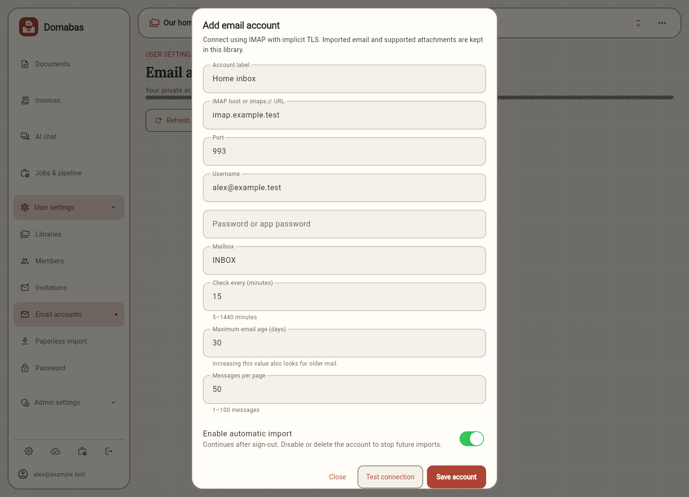
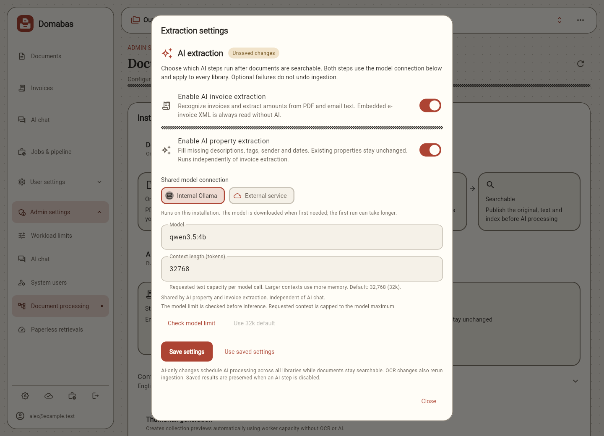
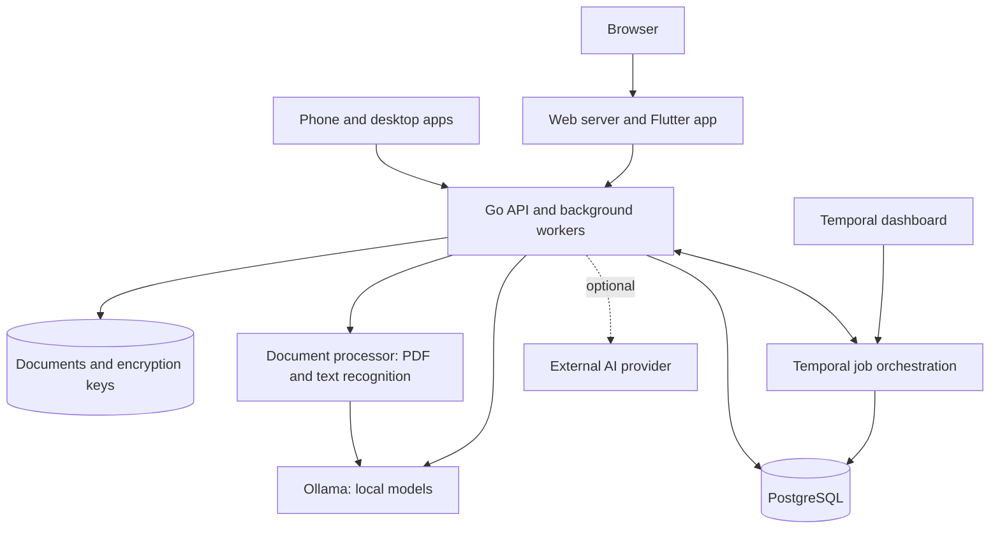

# Domabas

**All your home documents. One searchable home.**

Stop digging through basement boxes for that one receipt. Domabas is an
all-in-one solution for digital home document management: collect your paperwork,
keep it organized, and find it when you need it. From insurance policies and
invoices to warranties and everyday mail, everything has a home on your own server.

[Features](#features) · [Screenshots](#screenshots) ·
[Hosting](#what-you-need-to-host-it) · [Components](#how-it-fits-together) ·
[Build an app](#build-an-app-on-your-computer) ·
[Development guide](docs/development/index.md)

## Features

| What you can do | How it helps |
| --- | --- |
| **Bring every document home** | Upload PDFs, images and emails (EML) from your computer or phone. Preview your originals in one library. |
| **Find it without the exact filename** | Text recognition and full-text indexing make your paperwork searchable. Semantic search finds related content by meaning, with tags and filters to narrow the results. |
| **Let your inbox file itself** | Connect an IMAP account for automatic email archiving. Supported attachments are extracted into their own documents and linked to the original email. |
| **Read German e-invoices** | Extract structured invoice data embedded in PDFs, including ZUGFeRD/Factur-X, and view the details alongside the source document. See [supported formats](docs/arch/backend/invoices.md#extraction). |
| **Spend less time typing invoice data** | Optional AI extracts invoice details from ordinary PDFs and emails. Accuracy depends on the model you choose; extracted values remain available for review. |
| **Turn paper into a PDF on your phone** | Android and iOS apps include a document scanner with page-edge detection, perspective correction and multi-page drafts. Capture, review and upload to your library. |
| **Ask your documents** | AI RAG chat searches and reads documents you can access to help answer your questions. Answer quality depends heavily on the model used. |
| **Keep processing through interruptions** | A durable jobs framework powered by Temporal keeps imports and processing moving through restarts, with retries, visible progress and failure details. |
| **Organize with less effort** | Categorize documents with tags, or enable AI to generate tags and other document properties for you. |

Keep a personal library or invite others into a shared one with permissions you
control. Already using Paperless-ngx? Import your existing documents from Settings.

Use Domabas in your browser, or build apps for **Android, iOS, Linux, macOS and
Windows**. Native installation and platform requirements are covered in the
[app guide](frontend/README.md); mobile scanning is available on Android and iOS.

## Choose your AI

New installations use `qwen3.5:4b` for chat, document properties and invoice AI.
Upgrades preserve saved model choices and context settings. Property extraction
and invoice AI start disabled; administrators can enable them under
Admin → Document processing. See the [AI configuration guide](docs/development/property-extraction.md)
for model selection, external providers and GPU setup.

Run models locally with Ollama or connect an OpenAI-compatible service. AI chat
has its own model settings under Admin → AI chat. Choose models that suit your
hardware and documents, and review AI-generated results.

Open **User settings → Licenses** to search third-party components and read their
license notices offline. Distributors should also read the
[license inventory and commercial review](third_party/README.md#complete-inventory-and-app-screen).

## Screenshots

The grid at the top and the views below are captured from the running local app
with fictional sample content.

### Follow every job

See how an upload becomes a searchable document, then follow its separate invoice
and AI processing. Jobs & pipeline brings progress and outcomes into one view.


### Connect your email

Set up your mailbox, choose an import schedule, and let new emails and supported
attachments arrive in your library automatically.



### Make AI work for your setup

Choose a local or external model and enable invoice extraction and document
properties independently.



See [screenshot notes](docs/screenshots/index.md) for capture details and more views.

## What you need to host it

The complete web app runs with Docker Compose. You do not need Go, Flutter or
other development tools on the host.

| Requirement | Starting point |
| --- | --- |
| **Container runtime** | Docker with [Compose v2 or newer](https://docs.docker.com/compose/install/). ARM64 hosts need AMD64 emulation for the current web build stage. |
| **CPU and memory** | Start with **4 CPU cores and 5 GiB available RAM** for a small home library, plus memory for Ollama models when using AI. Leave capacity for your operating system and other services. |
| **Storage** | Persistent space for original files, the database, encryption keys and model caches, plus temporary processing space and backups. Size this for your library and chosen models. |
| **Network** | Internet access for the initial image and model downloads. HTTP works on LAN addresses; HTTPS encrypts traffic for remote access. |
| **GPU** | Optional. CPU operation is supported; NVIDIA and AMD setups need compatible hardware and drivers. |

Memory needs grow with document size, concurrent jobs and model context. Search
embeddings also use Ollama; allow for their model alongside any optional chat or
extraction models. See the [resource guide](docs/development/resources.md) for
service ceilings and sizing.

From a checkout of this repository:

```sh
docker compose up --build --wait
```

Open **http://localhost:8088** and create an account. On a new, empty installation,
the first account becomes the system administrator. Initial startup can take a
while as images and models download.

Use the [self-hosting guide](docs/development/compose.md) for configuration,
HTTPS, storage and upgrades. The [TrueNAS guide](truenas/README.md) provides
CPU, NVIDIA and AMD examples with application image placeholders. **Public GitHub
image references will follow.** Replace the placeholders with matching real image
versions and digests before deploying those examples. The
[release guide](docs/development/releases.md) describes versioned GHCR containers
and the checks that run before publication.

## Build an app on your computer

Build your own Android, Windows, Mac or iPhone/iPad app with one command after
installing the required tools. Start with the
[step-by-step app build guide](docs/development/build-apps.md): it explains what
to install, which setup commands must run first, and how to open the finished app.
No programming experience is assumed.

Run these commands in the downloaded repository folder **after the guide's
first-time setup**:

| App | Command | Build computer |
| --- | --- | --- |
| Android | `task build:android -- --release` | Windows, Mac or Linux |
| Mac | `task build:macos` | Mac with full Xcode |
| iPhone / iPad | `task build:ios` | Mac with full Xcode |
| Windows | `task build:windows` | Windows with Visual Studio C++ tools |

The commands download the app's dependencies and print where to find the output.
You do not need to run `task setup` or `task generate` first. The iOS command
builds an **unsigned app**; follow the guide's Xcode signing steps to install it
on your device, or use `task build:ios -- --simulator` for a simulator build.
The apps connect to your existing Domabas server; enter its HTTP or HTTPS address when
you first open them.

## Use at your own risk

Domabas is under active development and is provided as-is under the
[MIT license](LICENSE). **Use it at your own risk.** Bugs or operational failures
can cause data loss. Keep independent backups of important documents and the
installation's data and encryption keys. Review extracted text, invoice values
and AI answers before relying on them. If you configure an external AI provider,
document text and chat content used by that feature can leave your server.
Read [Data and privacy](docs/development/privacy.md) for storage locations,
deletion limits, encryption responsibilities and sensitive logging behavior.

## How it fits together

The app talks to one Go backend. PostgreSQL stores records and job state;
original files live in persistent storage. Temporal keeps background work moving
through restarts. The document processor reads files and recognizes text, while
Ollama provides local models for search and AI features.



The [architecture overview](architecture.md) explains each component and how
uploads, search, scheduling and AI work together.

## Security limitations

Domabas is not hardened against malicious documents or uploads, abusive use or
resource-exhaustion attacks. Run it privately for trusted users; do not expose it
as a public upload service.
