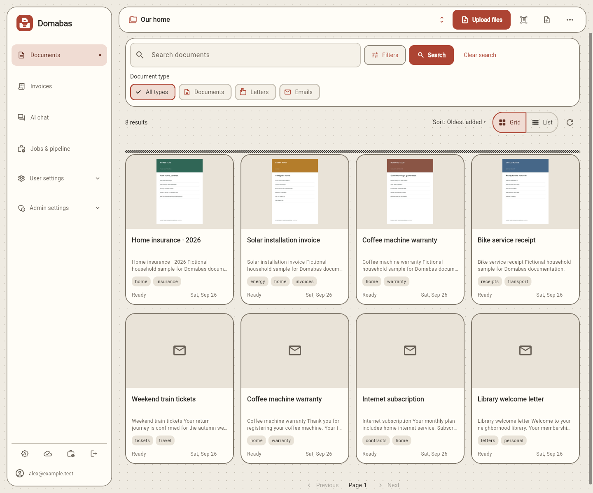
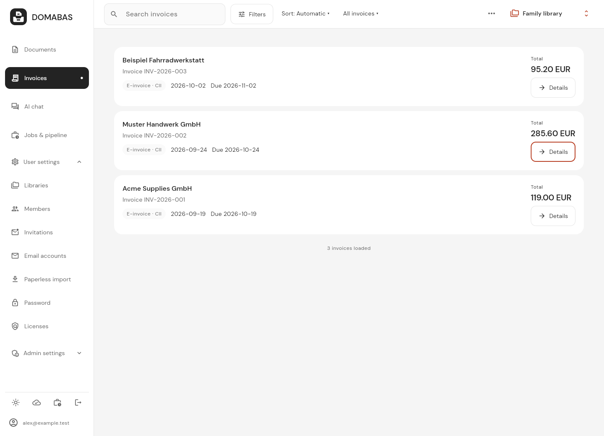
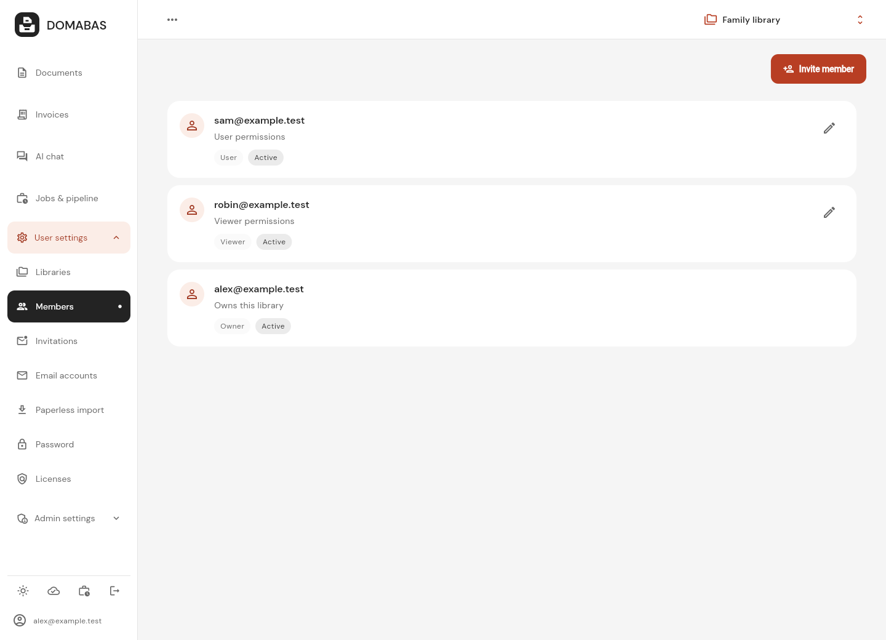
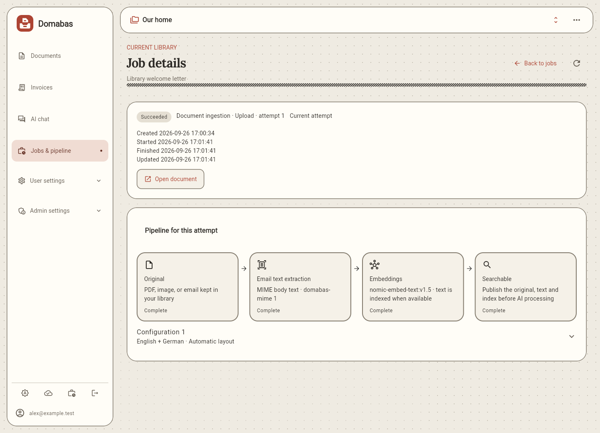
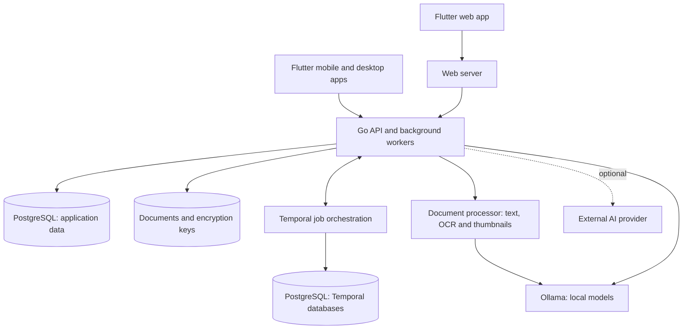

# Domabas

**All your documents, searchable in one central place.**

Domabas is a self-hosted document library. Upload and organize your documents,
search their contents, and share libraries with other users. Storage, document
processing and AI can all run on your own hardware.

[Features](#features) · [AI](#how-ai-is-used) · [Screenshots](#screenshots) ·
[Hosting](#what-you-need-to-host-it) · [Components](#how-it-fits-together) ·
[Build an app](#build-an-app-on-your-computer) ·
[Development guide](docs/development/index.md)

## Features

- **Upload documents:** Upload PDFs, PNG/JPEG images and email files (EML).
  Domabas extracts text, runs OCR where needed and creates thumbnails for PDFs
  and images.
- **Scan documents on mobile:** Use the camera on Android or iOS to scan pages,
  review them and upload a PDF to your library.
- **Search documents:** Use full-text and semantic search to find documents by
  their words or meaning.
- **Organize documents:** Add tags and properties, then filter by tag, document
  type, sender or recipient.
- **Import email automatically:** Connect an IMAP mailbox to import emails on a
  schedule. Supported attachments become separate, linked documents.
- **Read German invoice data:** Read structured invoice data embedded in PDFs,
  including ZUGFeRD/Factur-X. Optional AI extracts invoice details from ordinary
  documents. See [supported formats](docs/arch/backend/invoices.md#extraction).
- **AI chat:** Ask questions about documents you can access, with links to the
  documents used in the answer.
- **Import from Paperless-ngx:** Move your documents and supported metadata,
  including tags, into Domabas.
- **Multiple libraries and users:** Each user gets a personal library and can
  share it with other users. Switch between your own and shared libraries, with
  roles and permissions controlling access.
- **Run privately:** Host storage, processing, search and AI locally. No cloud
  account is required. See [data and privacy](docs/development/privacy.md) for
  optional external services and mobile scanner data flows.
- **Web, mobile and desktop:** Use the browser app or build apps for Android,
  iOS, Linux, macOS and Windows. Mobile apps also support sharing documents from
  other apps. See the [app guide](frontend/README.md).

## How AI is used

Ollama runs the embedding model that turns document text and search queries into
representations of their meaning. These embeddings make semantic search possible
and run locally in the default setup, even when optional AI features are disabled.

Ollama can also run models for chat, document properties and invoice extraction.
Smaller models need less memory and are a starting point. For better answers and
extraction, we recommend larger, more capable models when your hardware allows.
You can also connect an OpenAI-compatible service, including one you host yourself.

Chat and AI extraction are still under heavy development. Results depend on the
model and documents, so review them before relying on them. Property and invoice
AI start disabled; administrators can enable them under Admin → Document
processing. Chat has separate settings under Admin → AI chat. See the
[AI configuration guide](docs/development/property-extraction.md) for model
selection, providers and GPU setup.

## Screenshots

These screenshots show the web app with fictional documents and users.

**Document grid**



<details>
<summary>Invoices</summary>



</details>

<details>
<summary>Users and shared libraries</summary>



</details>

<details>
<summary>Processing jobs</summary>



</details>

See the [screenshot guide](docs/screenshots/index.md) for capture details.

## What you need to host it

The complete web app runs with Docker Compose. You do not need Go, Flutter or
other development tools on the host.

| Requirement | Starting point |
| --- | --- |
| **Container runtime** | Docker with [Compose v2 or newer](https://docs.docker.com/compose/install/). ARM64 hosts need AMD64 emulation for the current web build stage. |
| **CPU and memory** | Start with **4 CPU cores and 5 GiB available RAM** for a small home library, plus memory for Ollama's embedding model and any chat or extraction models. Leave capacity for your operating system and other services. |
| **Storage** | Persistent space for original files, the database, encryption keys and model caches, plus temporary processing space and backups. Size this for your library and chosen models. |
| **Network** | Internet access for the initial image and model downloads. HTTP works on LAN addresses; HTTPS encrypts traffic for remote access. |
| **GPU** | Optional. CPU operation is supported; NVIDIA and AMD setups need compatible hardware and drivers. |

Memory needs grow with document size, concurrent jobs and model context. Search
embeddings also use Ollama; allow for their model alongside any optional chat or
extraction models. See the [resource guide](docs/development/resources.md) for
service ceilings and sizing.

From a checkout of this repository:

```sh
docker compose up --build --wait
```

Open **http://localhost:8088** and create an account. On a new, empty installation,
the first account becomes the system administrator. Initial startup can take a
while as images and models download.

Use the [self-hosting guide](docs/development/compose.md) for configuration,
HTTPS, storage and upgrades. The [TrueNAS guide](truenas/README.md) provides
CPU, NVIDIA and AMD examples pinned to the matching
[v0.0.10 container images](https://github.com/saschTa/domabas/releases/tag/v0.0.10).
Set your passwords, dataset path and network addresses before deploying. Private
GHCR packages require registry authentication. The
[release guide](docs/development/releases.md) describes versioned GHCR containers
and the checks that run before publication.

## Build an app on your computer

Build your own Android, Windows, Mac or iPhone/iPad app with one command after
installing the required tools. Start with the
[step-by-step app build guide](docs/development/build-apps.md): it explains what
to install, which setup commands must run first, and how to open the finished app.
No programming experience is assumed.

Run these commands in the downloaded repository folder **after the guide's
first-time setup**:

| App | Command | Build computer |
| --- | --- | --- |
| Android | `task build:android -- --release` | Windows, Mac or Linux |
| Mac | `task build:macos` | Mac with full Xcode |
| iPhone / iPad | `task build:ios` | Mac with full Xcode |
| Windows | `task build:windows` | Windows with Visual Studio C++ tools |

The commands download the app's dependencies and print where to find the output.
You do not need to run `task setup` or `task generate` first. The iOS command
builds an **unsigned app**; follow the guide's Xcode signing steps to install it
on your device, or use `task build:ios -- --simulator` for a simulator build.
The apps connect to your existing Domabas server; enter its HTTP or HTTPS address when
you first open them.

## Use at your own risk

Domabas is under active development and is provided as-is under the
[MIT license](LICENSE). **Use it at your own risk.** Bugs or operational failures
can cause data loss. Keep independent backups of important documents and the
installation's data and encryption keys. Review extracted text, invoice values
and AI answers before relying on them. If you configure an external AI provider,
document text and chat content used by that feature can leave your server.
Read [Data and privacy](docs/development/privacy.md) for storage locations,
deletion limits, encryption responsibilities and sensitive logging behavior.

## How it fits together

The Flutter app talks to one Go backend, which serves the API and runs background
workers. PostgreSQL stores application records and job progress, with separate
databases for Temporal's workflow history. Original files live in persistent
storage. Temporal coordinates jobs through restarts. A private document processor
extracts text, runs OCR, creates thumbnails and asks Ollama for search embeddings.
The backend uses local or optional external models for chat and AI extraction.



The [architecture overview](architecture.md) explains each component and how
uploads, search, scheduling and AI work together.

## Security limitations

Domabas is not hardened against malicious documents or uploads, abusive use or
resource-exhaustion attacks. Run it privately for trusted users; do not expose it
as a public upload service.
