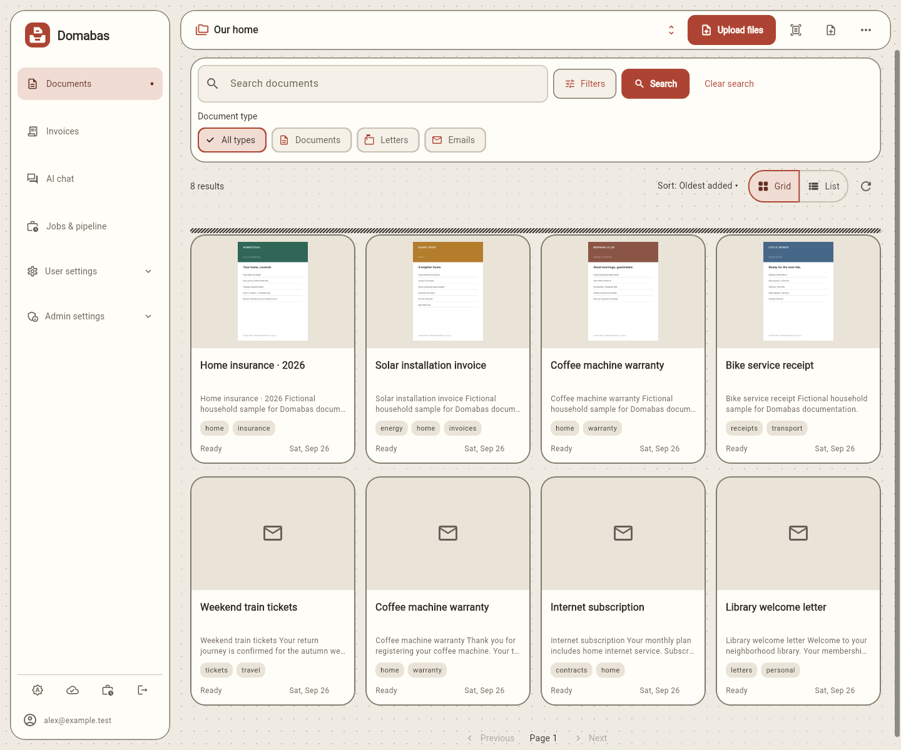
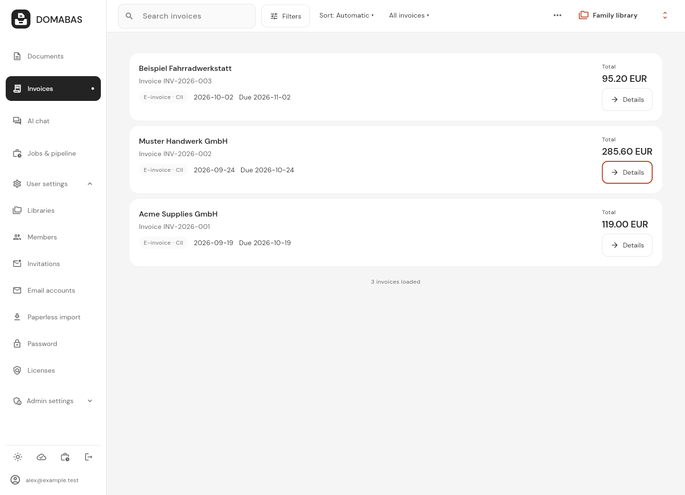
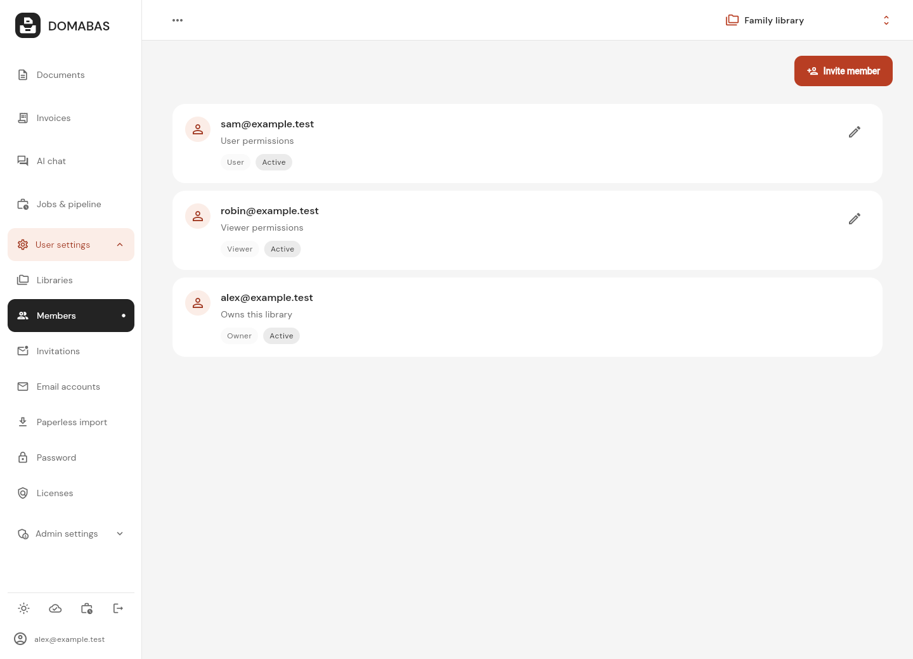
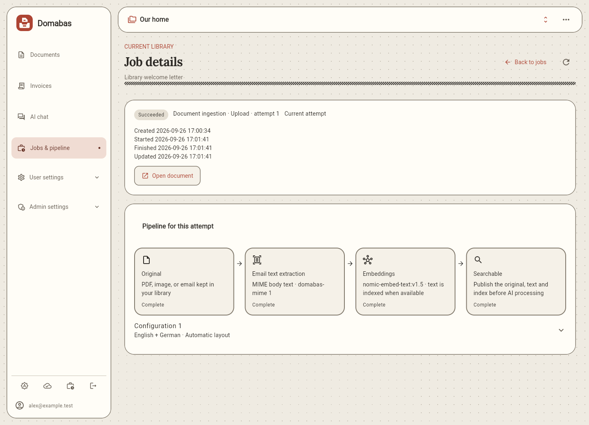
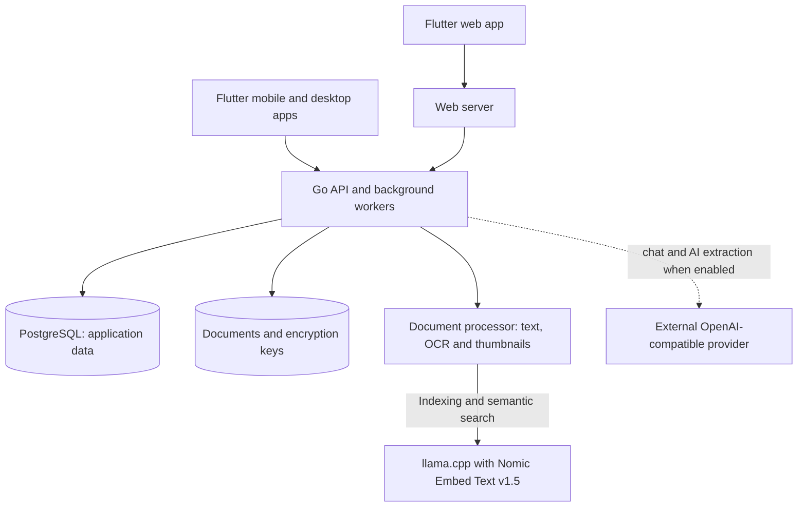

# Domabas

**All your documents, searchable in one central place.**

Domabas is a self-hosted document library. Upload and organize your documents,
search their contents, and share libraries with other users. Storage, document
processing and AI can all run on your own hardware.

[Quick start](#quick-start) · [Features](#features) · [AI](#how-ai-is-used) · [Screenshots](#screenshots) ·
[Hosting](#what-you-need-to-host-it) · [Components](#how-it-fits-together) ·
[Build an app](#build-an-app-on-your-computer) ·
[Development guide](docs/development/index.md)

## Quick start

Download or clone this repository. From its root, start the application with Docker Engine 25+ and Docker Compose 2.20.2+.

```sh
docker compose up --build --wait
```

Open **http://localhost:8088** and create an account. The first account on a fresh installation becomes its system administrator. On first startup, Docker builds the application and the model initializer downloads a verified 274 MB embedding model. Later starts reuse its volume. Use `docker compose logs -f` to watch progress.

To install published images, use the standalone Compose configuration in the notes for the release you choose. Its images and configuration belong to that release. The [quick-start file](compose.quickstart.yaml) in the source checkout includes its sibling [compose.yaml](compose.yaml).

Stop the stack with `docker compose down`. Docker retains documents, database records, keys and models for the next start. Set passwords and network addresses before sharing the installation. See the [hosting guide](docs/development/compose.md).

## Features

- **Upload documents:** Upload PDFs, PNG/JPEG images and email files (EML).
  Domabas extracts text, runs OCR where needed and creates thumbnails for PDFs
  and images.
- **Scan documents on mobile:** Use the camera on Android or iOS to scan pages,
  review them and upload a PDF to your library.
- **Search documents:** Use full-text and semantic search to find documents by
  their words or meaning.
- **Organize documents:** Add tags and properties, then filter by tag, document
  type, sender or recipient.
- **Import email automatically:** Connect an IMAP mailbox to import emails on a
  schedule. Supported attachments become separate, linked documents.
- **Read German invoice data:** Read structured invoice data embedded in PDFs,
  including ZUGFeRD/Factur-X. Optional AI extracts invoice details from ordinary
  documents. See [supported formats](docs/arch/backend/invoices.md#extraction).
- **AI chat:** Ask questions about documents you can access, with links to the
  documents used in the answer.
- **Import from Paperless-ngx:** Move your documents and supported metadata,
  including tags, into Domabas.
- **Multiple libraries and users:** Each user gets a personal library and can
  share it with other users. Switch between your own and shared libraries, with
  roles and permissions controlling access.
- **Run privately:** Keep documents, OCR and semantic search on your server.
  For private chat and AI extraction, connect an OpenAI-compatible provider you
  host yourself. See [data and privacy](docs/development/privacy.md).
- **Web, mobile and desktop:** Use the browser app or build apps for Android,
  iOS, Linux, macOS and Windows. Mobile apps also support sharing documents from
  other apps. See the [app guide](frontend/README.md).

## How AI is used

Domabas runs Nomic Embed Text v1.5 locally with llama.cpp to index document passages and answer semantic searches. The default CPU deployment works without a GPU. A Linux Vulkan override can accelerate the same model. Search, OCR and structured invoice XML processing work before any external model is configured.

Chat and AI extraction start disabled. An administrator can connect an OpenAI-compatible provider, including a self-hosted service. Chat has its own URL, model and optional key under **Admin → AI chat**. Property and invoice AI share a connection under **Admin → Document processing** and can be enabled independently. Enabling these features sends relevant document content to the selected service. Review generated answers and extracted values. See the [AI configuration guide](docs/development/property-extraction.md).

## Screenshots

These screenshots show the web app with fictional documents and users.

**Document grid**



<details>
<summary>Invoices</summary>



</details>

<details>
<summary>Users and shared libraries</summary>



</details>

<details>
<summary>Processing jobs</summary>



</details>

See the [screenshot guide](docs/screenshots/index.md) for capture details.

## What you need to host it

The complete web app runs with Docker Compose. You do not need Go, Flutter or
other development tools on the host.

| Requirement | Starting point |
| --- | --- |
| **Container runtime** | Docker Engine 25+ with [Compose 2.20.2+](https://docs.docker.com/compose/install/). ARM64 hosts need AMD64 emulation for the published images and the web build stage when building from source. |
| **CPU and memory** | For a small library, start with **4 CPU cores and 5 GiB of RAM for the base application**, plus room for local embeddings. The embedding container has a **2 GiB** default memory limit. Leave headroom for the operating system. |
| **Storage** | Allow **274 MB** for the cached Nomic embedding model, plus space for OCR models, container images, originals, database and search indexes, encryption keys, temporary processing files and backups. |
| **Network** | Internet access for the initial image and model downloads. HTTP works on LAN addresses; HTTPS encrypts traffic for remote access. |
| **GPU** | CPU embeddings work by default. For GPU acceleration, use the [Linux Vulkan override](docs/development/compose.md#select-the-embedding-runtime) with a compatible driver and an accessible render node. |

Memory needs grow with document size and concurrent jobs. If you also host a
chat or extraction provider, budget for that service separately. See the
[resource guide](docs/development/resources.md) for the individual container limits.

Use the [quick start](#quick-start) to run the source checkout. The
[self-hosting guide](docs/development/compose.md) covers configuration, building
from source, HTTPS, storage and upgrades. The [TrueNAS guide](truenas/README.md)
provides CPU and Vulkan templates.
Set your passwords, dataset path and network addresses before deploying. Private
GHCR packages require registry authentication. The
[release guide](docs/development/releases.md) describes versioned GHCR containers,
Android preview APKs, unsigned macOS DMGs and the checks before publication.

## Build an app on your computer

New releases also provide Android APK and macOS DMG downloads. They use
development signing on Android and have no Apple notarization on macOS; see
[native preview downloads](docs/development/releases.md#native-preview-downloads)
for installation and update limits.

Build your own Android, Windows, Mac or iPhone/iPad app with one command after
installing the required tools. Start with the
[step-by-step app build guide](docs/development/build-apps.md): it explains what
to install, which setup commands must run first, and how to open the finished app.
No programming experience is assumed.

Run these commands in the downloaded repository folder **after the guide's
first-time setup**:

| App | Command | Build computer |
| --- | --- | --- |
| Android | `task build:android -- --release` | Windows, Mac or Linux |
| Mac | `task build:macos` | Mac with full Xcode |
| iPhone / iPad | `task build:ios` | Mac with full Xcode |
| Windows | `task build:windows` | Windows with Visual Studio C++ tools |

The commands download the app's dependencies and print where to find the output.
You do not need to run `task setup` or `task generate` first. The iOS command
builds an **unsigned app**; follow the guide's Xcode signing steps to install it
on your device, or use `task build:ios -- --simulator` for a simulator build.
The apps connect to your existing Domabas server; enter its HTTP or HTTPS address when
you first open them.

## Use at your own risk

Domabas is under active development and is provided as-is under the
[MIT license](LICENSE). **Use it at your own risk.** Bugs or operational failures
can cause data loss. Keep independent backups of important documents and the
installation's data and encryption keys. Review extracted text, invoice values
and AI answers before relying on them. If you configure an external AI provider,
document text and chat content used by that feature can leave your server.
Read [Data and privacy](docs/development/privacy.md) for storage locations,
deletion limits, encryption responsibilities and sensitive logging behavior.

For a NAS installation from source, see the [TrueNAS templates and image build instructions](truenas/README.md#1-choose-a-file).

## How it fits together

The Flutter app talks to one Go backend, which serves the API and runs background
workers. PostgreSQL stores application records, job progress and resource limits.
Workers resume from saved checkpoints after a restart. Original files live in persistent storage. A private document processor
extracts text, runs OCR, creates thumbnails and asks llama.cpp for search embeddings.
The backend uses an optional external provider for chat and AI extraction.



The [architecture overview](architecture.md) explains each component and how
uploads, search, scheduling and AI work together.

## Security limitations

Domabas is not hardened against malicious documents or uploads, abusive use or
resource-exhaustion attacks. Run it privately for trusted users; do not expose it
as a public upload service.
